# Session 5: Databricks: Slides

 **Prepared by Ir. UWAYO Jacques** · [Follow me on LinkedIn](https://www.linkedin.com/in/uwayo/)

Each slide as an image, with its text underneath. See [study-guide.md](study-guide.md) for the full explanation, steps and practice. You can also [download the slides as PDF](slides.pdf).

---

## Slide 1: Introduction to Databricks

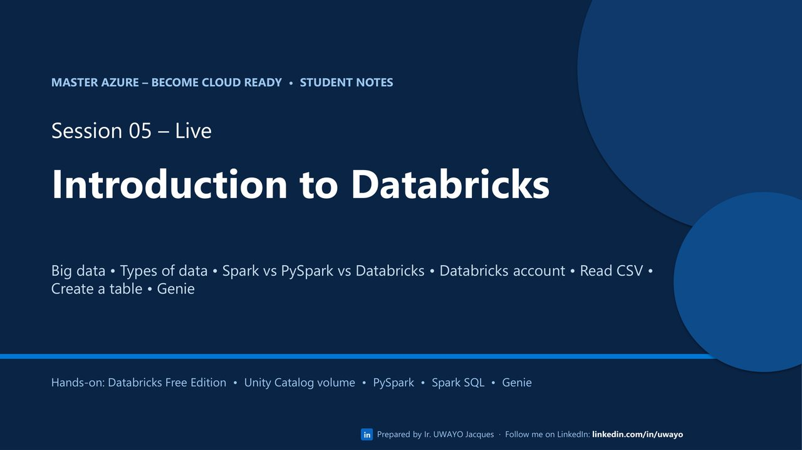

- Session 05 – Live  |  Student Notes
- Big data • Types of data • Spark vs PySpark vs Databricks • Databricks account • Read CSV • Create a table • Genie

---

## Slide 2: Introduction: why this session matters

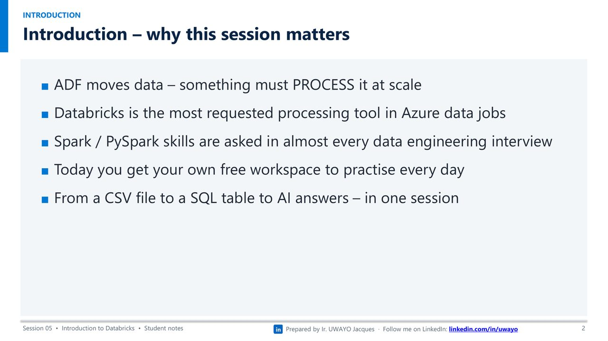

- ADF moves data – something must PROCESS it at scale
- Databricks is the most requested processing tool in Azure data jobs
- Spark / PySpark skills are asked in almost every data engineering interview
- Today you get your own free workspace to practise every day
- From a CSV file to a SQL table to AI answers – in one session

---

## Slide 3: Recap: where Databricks fits

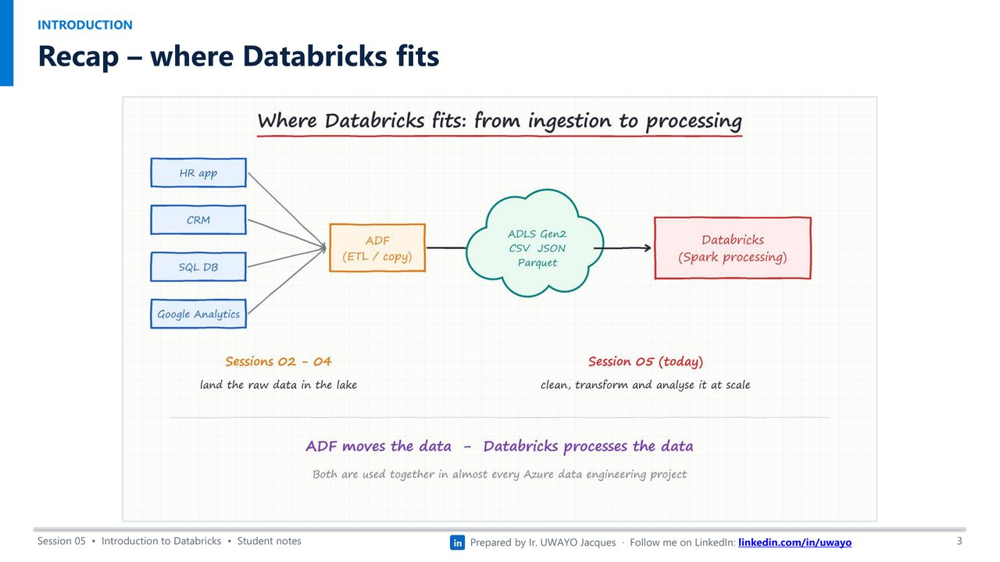

- Quick recap of the architecture we are building in this course: • Sources - business applications such as HR, CRM, SQL databases and web analytics. • Azure Data Factory - the ETL / orchestration tool that copies the data (Sessions 02-04). • ADLS Gen2 - the data lake that stores the raw files: CSV, JSON, Parquet. • Databricks - the processing layer: it reads the files, cleans and transforms them with Spark, and writes curated tables.

---

## Slide 4: Learning objectives

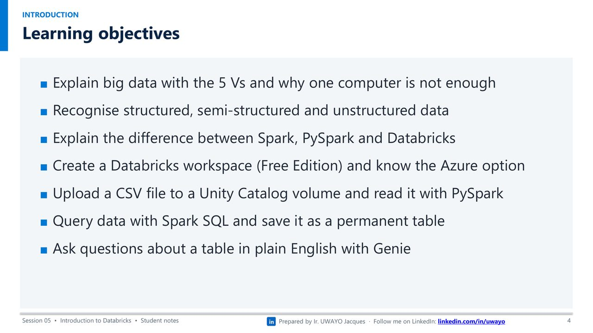

- Explain big data with the 5 Vs and why one computer is not enough
- Recognise structured, semi-structured and unstructured data
- Explain the difference between Spark, PySpark and Databricks
- Create a Databricks workspace (Free Edition) and know the Azure option
- Upload a CSV file to a Unity Catalog volume and read it with PySpark
- Query data with Spark SQL and save it as a permanent table
- Ask questions about a table in plain English with Genie

---

## Slide 5: Session agenda

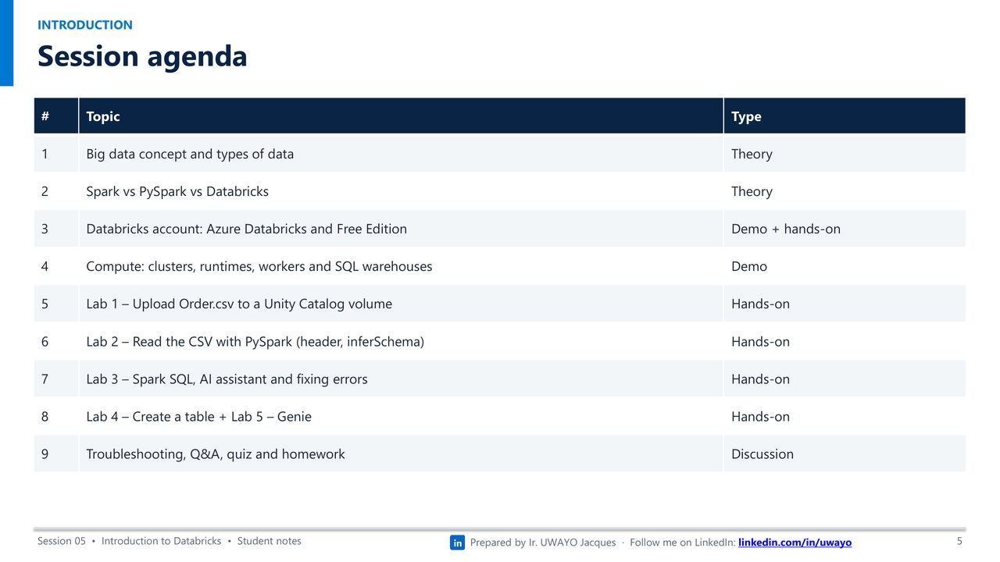

| # | Topic | Type |
| --- | --- | --- |
| 1 | Big data concept and types of data | Theory |
| 2 | Spark vs PySpark vs Databricks | Theory |
| 3 | Databricks account: Azure Databricks and Free Edition | Demo + hands-on |
| 4 | Compute: clusters, runtimes, workers and SQL warehouses | Demo |
| 5 | Lab 1 – Upload Order.csv to a Unity Catalog volume | Hands-on |
| 6 | Lab 2 – Read the CSV with PySpark (header, inferSchema) | Hands-on |
| 7 | Lab 3 – Spark SQL, AI assistant and fixing errors | Hands-on |
| 8 | Lab 4 – Create a table + Lab 5 – Genie | Hands-on |
| 9 | Troubleshooting, Q&A, quiz and homework | Discussion |

---

## Slide 6: Before we start: what you need

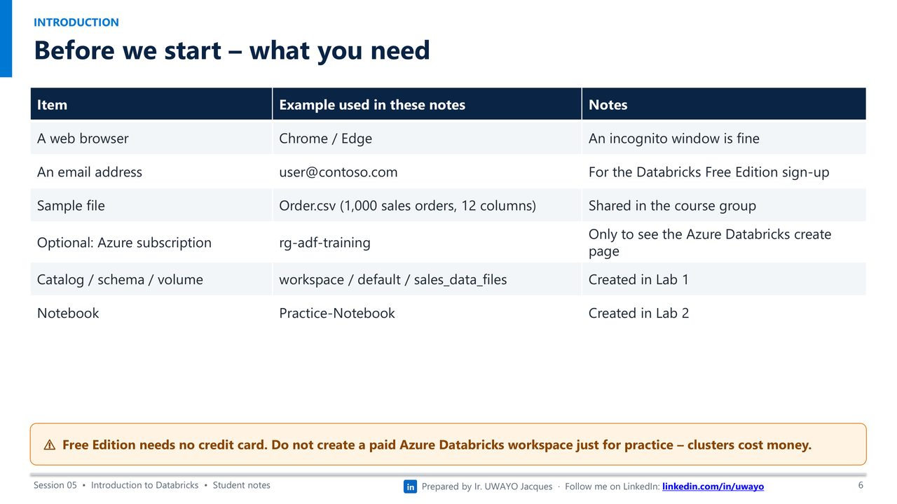

| Item | Example used in these notes | Notes |
| --- | --- | --- |
| A web browser | Chrome / Edge | An incognito window is fine |
| An email address | user@contoso.com | For the Databricks Free Edition sign-up |
| Sample file | Order.csv (1,000 sales orders, 12 columns) | Shared in the course group |
| Optional: Azure subscription | rg-adf-training | Only to see the Azure Databricks create page |
| Catalog / schema / volume | workspace / default / sales_data_files | Created in Lab 1 |
| Notebook | Practice-Notebook | Created in Lab 2 |

> **Tip:** Free Edition needs no credit card. Do not create a paid Azure Databricks workspace just for practice – clusters cost money.

---

## Slide 7: Part 1: Big data and types of data

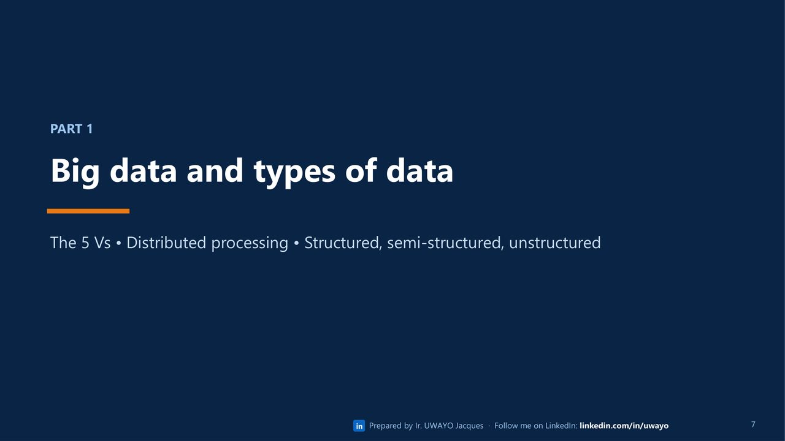

- The 5 Vs • Distributed processing • Structured, semi-structured, unstructured

---

## Slide 8: What is big data? The 5 Vs

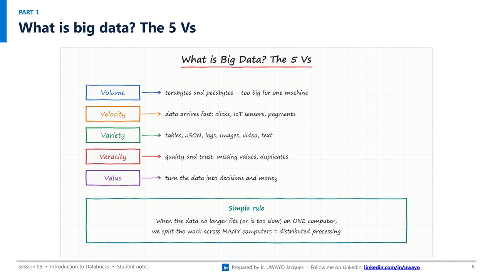

- Big data is data that is too large, too fast or too varied to be processed comfortably on one computer with traditional tools. It is usually described with five Vs: • Volume - the amount of data: terabytes or petabytes (orders, logs, sensor readings over years). • Velocity - the speed at which data arrives: card payments, website clicks, IoT sensors, every second. • Variety - the different shapes of data: tables, JSON, logs, images, video, free text. • Veracity - how trustworthy the data is: missing values, duplicates, wrong formats. • Value - the business benefit: better decisions, fraud detection, recommendations.

---

## Slide 9: Scaling out: one driver, many workers

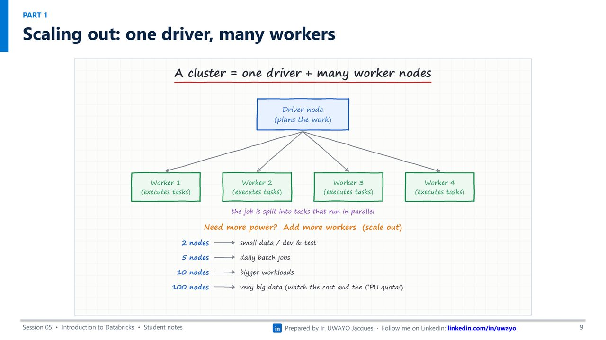

- There are two ways to get more power. Scale UP means buying a bigger single machine - it has a limit and gets very expensive. Scale OUT means adding more ordinary machines that work together - this is how big data systems work.

---

## Slide 10: Types of data

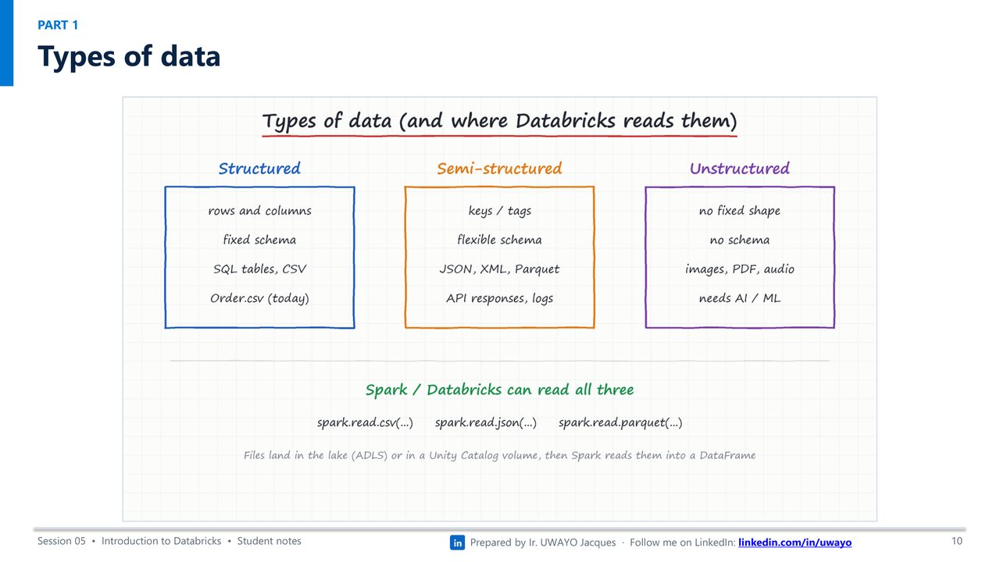

- • Structured data has a fixed schema of rows and columns: SQL tables and CSV files. Today's Order.csv is structured data. • Semi-structured data carries its structure with it through keys or tags, and the schema can vary: JSON, XML, and also Parquet files with nested fields. API responses and logs are typical examples. • Unstructured data has no schema: images, PDF documents, audio, video, free text. It usually needs AI or machine learning to extract value.

---

## Slide 11: Big data vocabulary you will hear

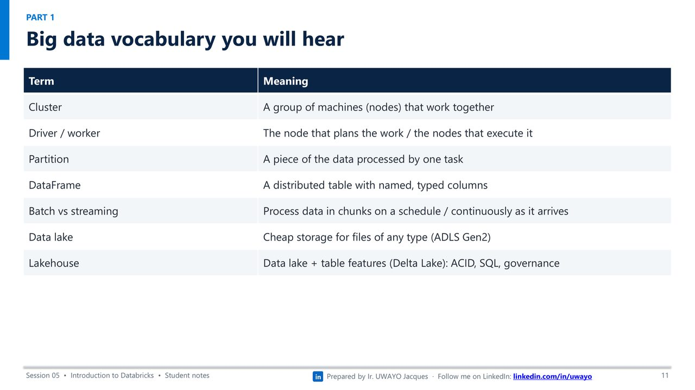

| Term | Meaning |
| --- | --- |
| Cluster | A group of machines (nodes) that work together |
| Driver / worker | The node that plans the work / the nodes that execute it |
| Partition | A piece of the data processed by one task |
| DataFrame | A distributed table with named, typed columns |
| Batch vs streaming | Process data in chunks on a schedule / continuously as it arrives |
| Data lake | Cheap storage for files of any type (ADLS Gen2) |
| Lakehouse | Data lake + table features (Delta Lake): ACID, SQL, governance |

---

## Slide 12: Part 2: Spark vs PySpark vs Databricks

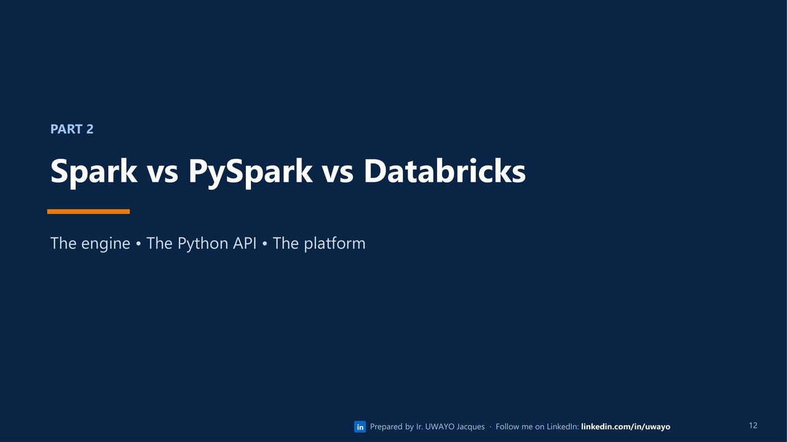

- The engine • The Python API • The platform

---

## Slide 13: Apache Spark: a distributed processing framework

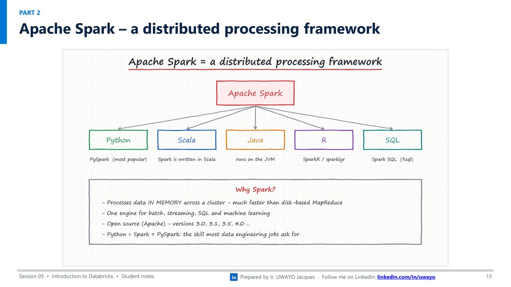

- Apache Spark is an open-source framework for processing large amounts of data on a cluster. It keeps data in memory between steps, which makes it much faster than the older Hadoop MapReduce approach that wrote to disk after every step.

---

## Slide 14: How PySpark talks to the Spark engine

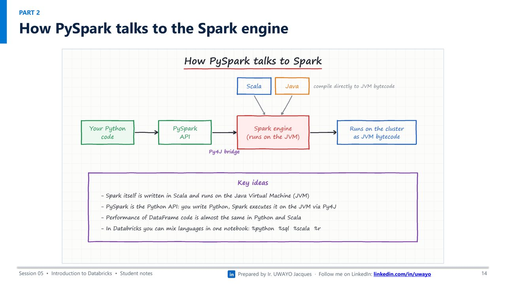

- Spark runs on the Java Virtual Machine (JVM). Scala and Java code compile directly into JVM bytecode.

---

## Slide 15: Spark vs PySpark vs Databricks

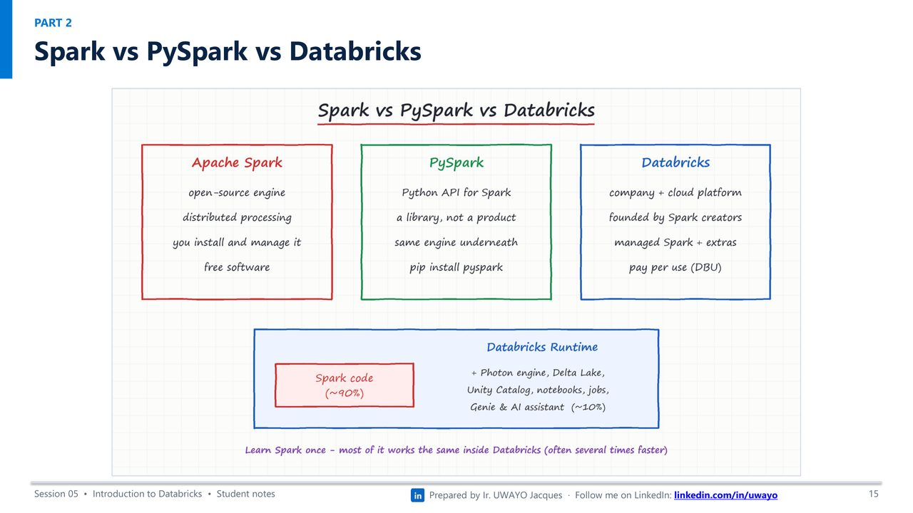

- • Apache Spark - the open-source processing engine. You can install it yourself, but then you manage the servers, versions, security and tuning. • PySpark - the Python library to write Spark code (pip install pyspark). It is not a separate product; it uses the same engine. • Databricks - a company founded by the original creators of Spark, and the cloud platform they sell. It runs managed Spark clusters for you, and adds its own features on top: the Databricks Runtime with the Photon engine (often several times faster than open-source Spark), Delta Lake, Unity Catalog for governance, notebooks, jobs, SQL warehouses, dashboards, Genie and an AI assistant.

---

## Slide 16: Spark vs PySpark vs Databricks: summary

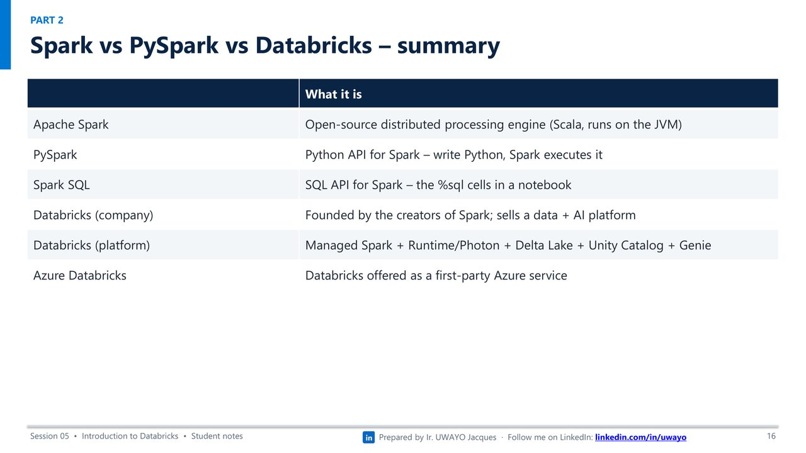

|  | What it is |
| --- | --- |
| Apache Spark | Open-source distributed processing engine (Scala, runs on the JVM) |
| PySpark | Python API for Spark – write Python, Spark executes it |
| Spark SQL | SQL API for Spark – the %sql cells in a notebook |
| Databricks (company) | Founded by the creators of Spark; sells a data + AI platform |
| Databricks (platform) | Managed Spark + Runtime/Photon + Delta Lake + Unity Catalog + Genie |
| Azure Databricks | Databricks offered as a first-party Azure service |

---

## Slide 17: Databricks runs on every major cloud

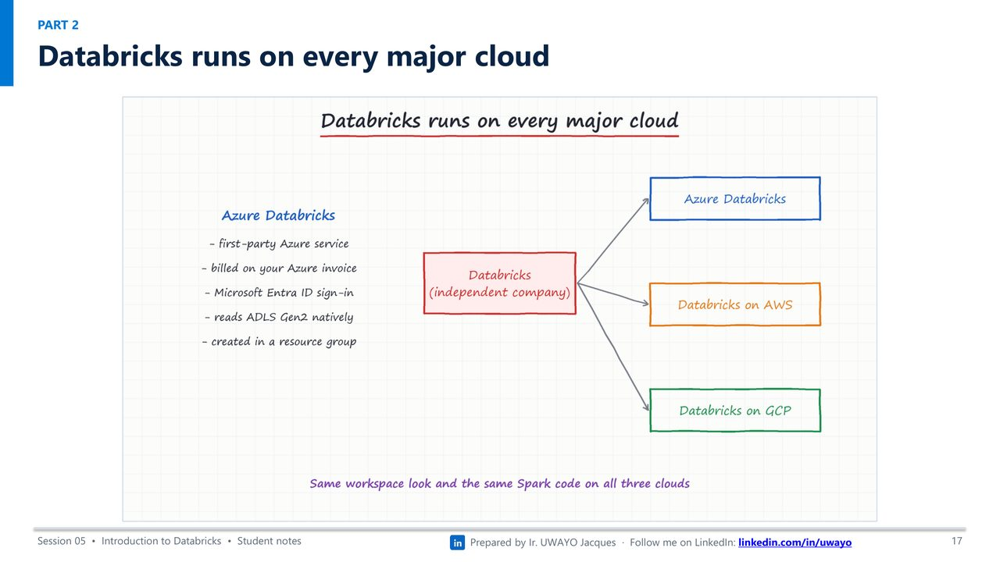

- Databricks is an independent company. Its platform runs on Microsoft Azure, AWS and Google Cloud, with the same workspace and the same Spark code.

---

## Slide 18: Part 3: How to create a Databricks account

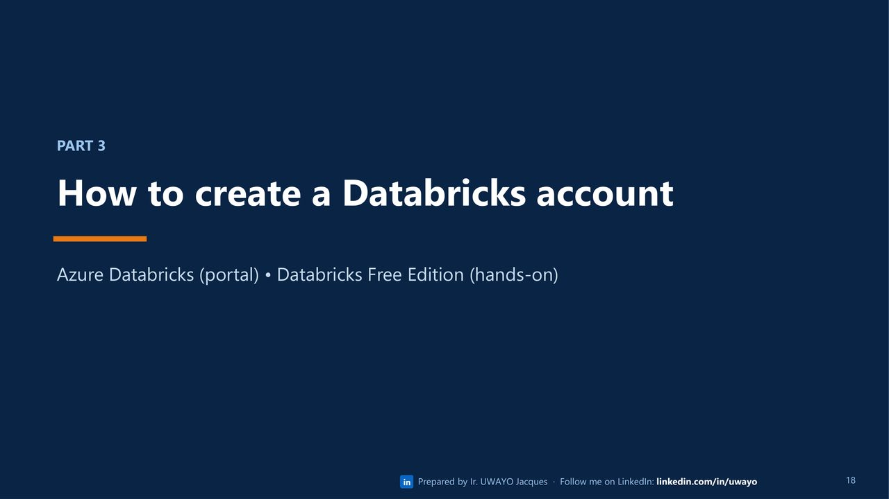

- Azure Databricks (portal) • Databricks Free Edition (hands-on)

---

## Slide 19: Two ways to get a Databricks workspace

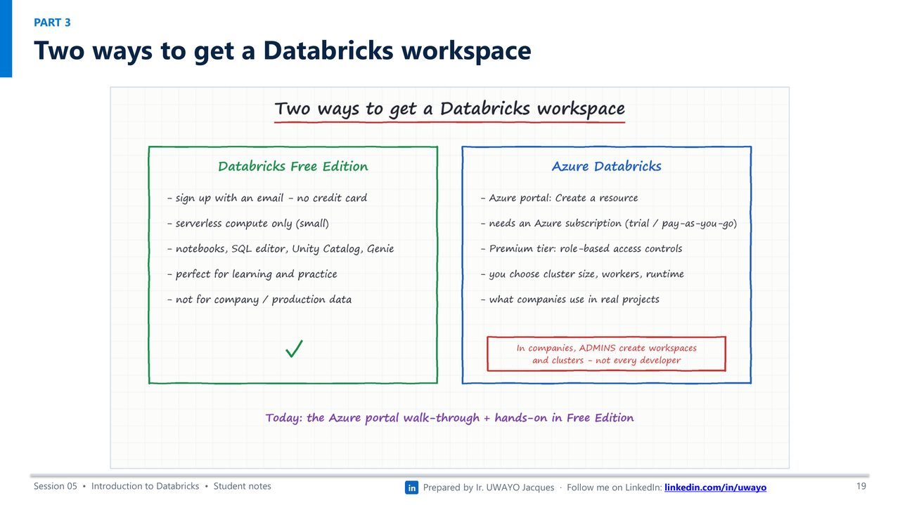

- 1. Azure Databricks - created from the Azure portal in your subscription. This is what companies use. Compute (clusters) is billed per DBU (Databricks Unit) plus the Azure virtual machines. 2. Databricks Free Edition - a free workspace hosted by Databricks for learning. No credit card, serverless compute only, with notebooks, SQL editor, Unity Catalog and Genie. It replaced the old Community Edition.

---

## Slide 20: Azure Databricks: Create a workspace (Basics)

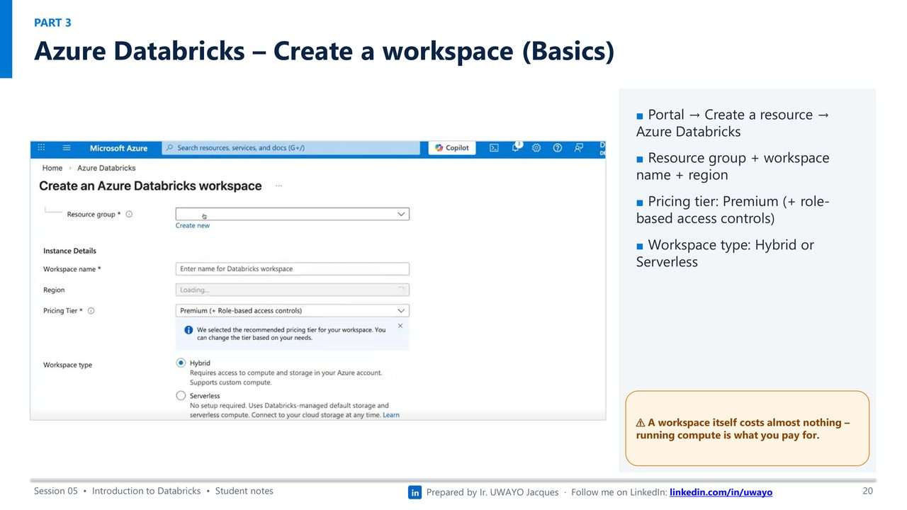

- Portal → Create a resource → Azure Databricks
- Resource group + workspace name + region
- Pricing tier: Premium (+ role-based access controls)
- Workspace type: Hybrid or Serverless

> **Tip:** A workspace itself costs almost nothing – running compute is what you pay for.

---

## Slide 21: Azure Databricks: Networking tab

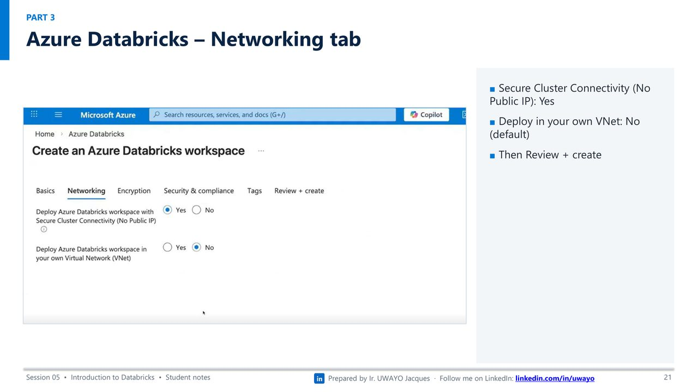

- Secure Cluster Connectivity (No Public IP): Yes
- Deploy in your own VNet: No (default)
- Then Review + create

---

## Slide 22: Who creates workspaces and clusters?

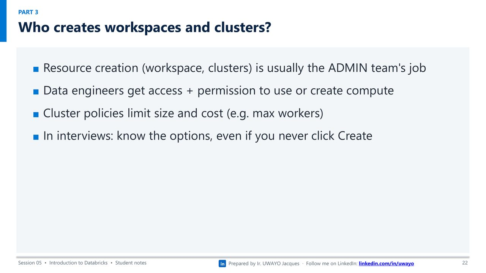

- Resource creation (workspace, clusters) is usually the ADMIN team's job
- Data engineers get access + permission to use or create compute
- Cluster policies limit size and cost (e.g. max workers)
- In interviews: know the options, even if you never click Create

---

## Slide 23: Free Edition: the sign-up page

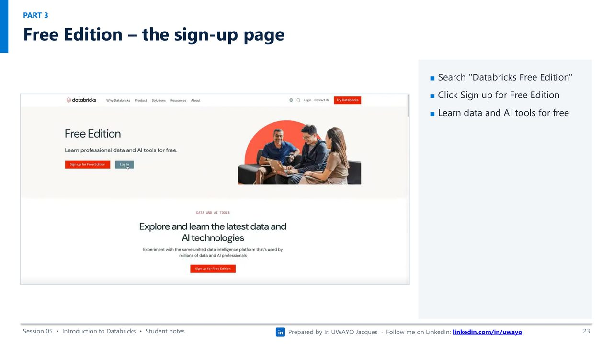

- Search "Databricks Free Edition"
- Click Sign up for Free Edition
- Learn data and AI tools for free

---

## Slide 24: Free Edition: sign up with email

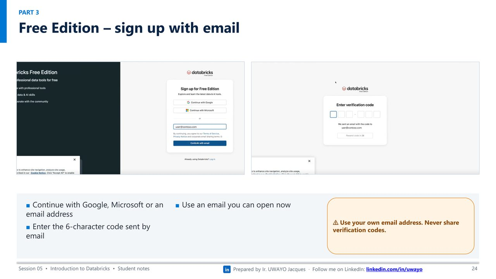

- Continue with Google, Microsoft or an email address
- Enter the 6-character code sent by email
- Use an email you can open now

> **Tip:** Use your own email address. Never share verification codes.

---

## Slide 25: Free Edition: set up your account

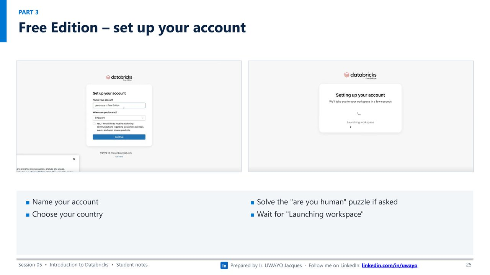

- Name your account
- Choose your country
- Solve the "are you human" puzzle if asked
- Wait for "Launching workspace"

---

## Slide 26: Welcome to your Databricks workspace

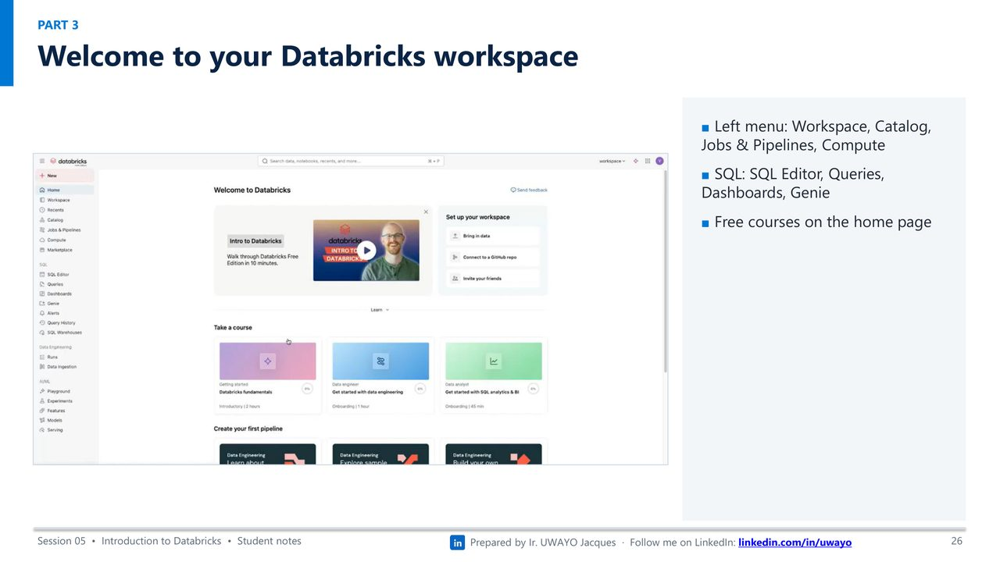

- Left menu: Workspace, Catalog, Jobs & Pipelines, Compute
- SQL: SQL Editor, Queries, Dashboards, Genie
- Free courses on the home page

---

## Slide 27: Workspace folders: your user folder

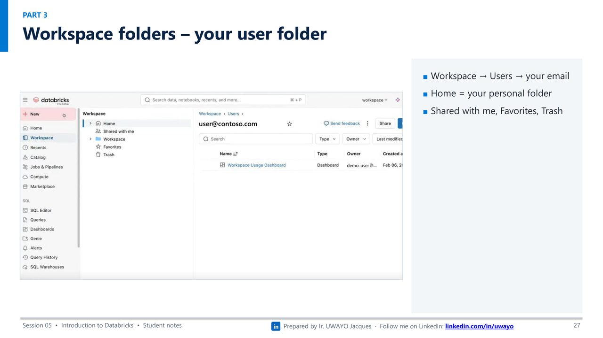

- Workspace → Users → your email
- Home = your personal folder
- Shared with me, Favorites, Trash

---

## Slide 28: Part 4: Compute: clusters and SQL warehouses

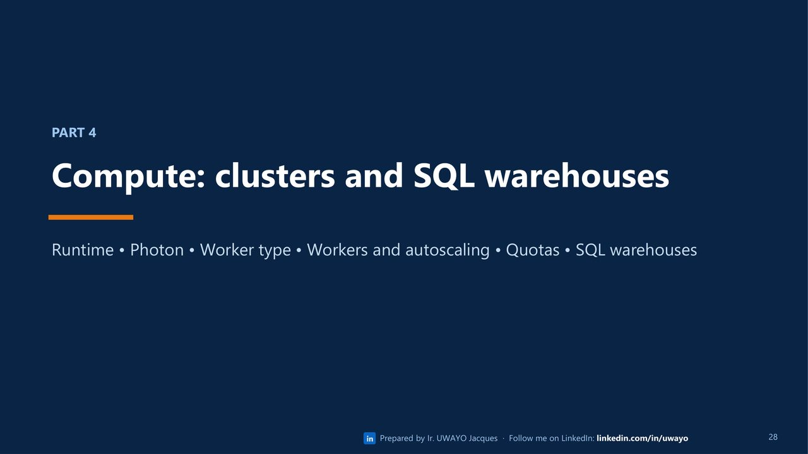

- Runtime • Photon • Worker type • Workers and autoscaling • Quotas • SQL warehouses

---

## Slide 29: Create new compute (Azure Databricks)

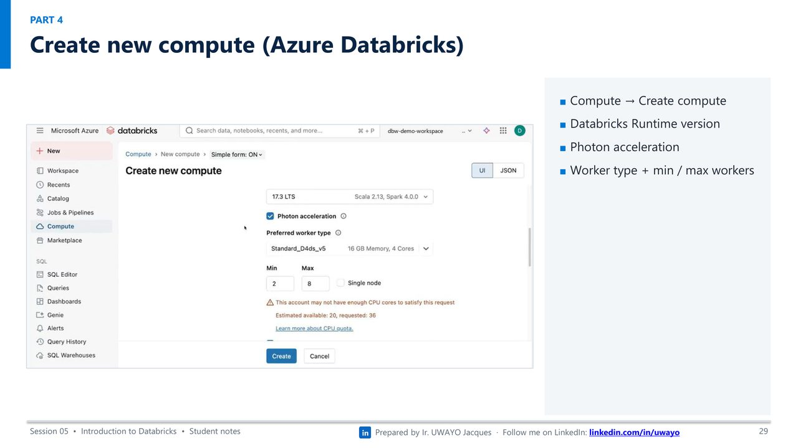

- Compute → Create compute
- Databricks Runtime version
- Photon acceleration
- Worker type + min / max workers

---

## Slide 30: Databricks Runtime versions

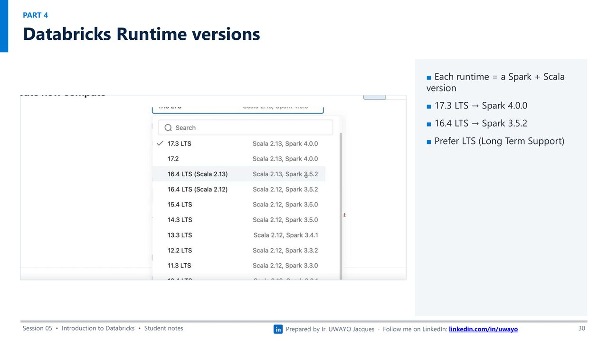

- Each runtime = a Spark + Scala version
- 17.3 LTS → Spark 4.0.0
- 16.4 LTS → Spark 3.5.2
- Prefer LTS (Long Term Support)

---

## Slide 31: Workers, autoscaling and auto-termination

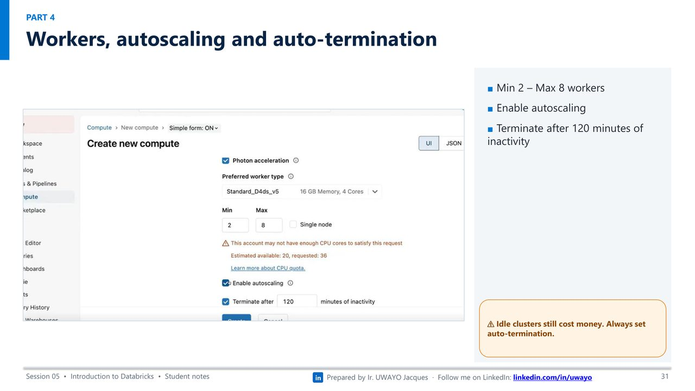

- Min 2 – Max 8 workers
- Enable autoscaling
- Terminate after 120 minutes of inactivity

> **Tip:** Idle clusters still cost money. Always set auto-termination.

---

## Slide 32: CPU quota: why big clusters fail

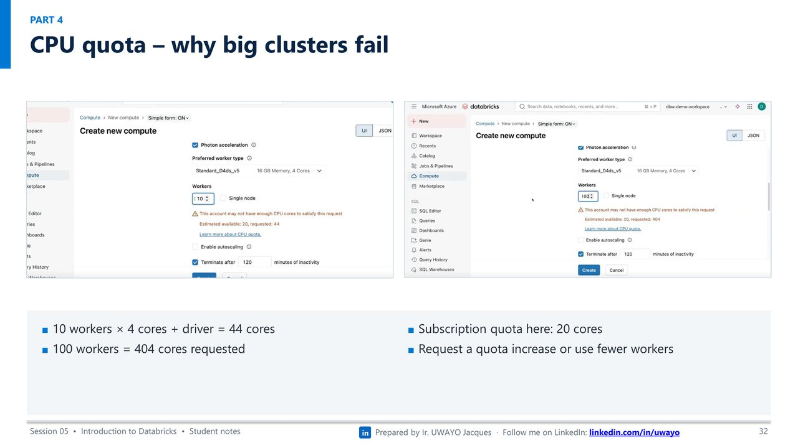

- 10 workers × 4 cores + driver = 44 cores
- 100 workers = 404 cores requested
- Subscription quota here: 20 cores
- Request a quota increase or use fewer workers

---

## Slide 33: Compute summary and price

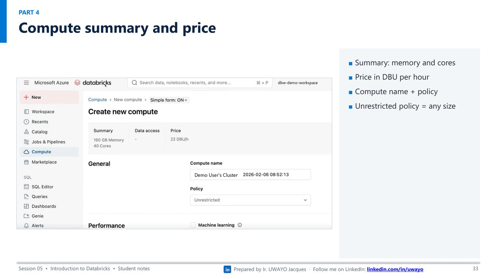

- Summary: memory and cores
- Price in DBU per hour
- Compute name + policy
- Unrestricted policy = any size

---

## Slide 34: Compute list: all-purpose compute

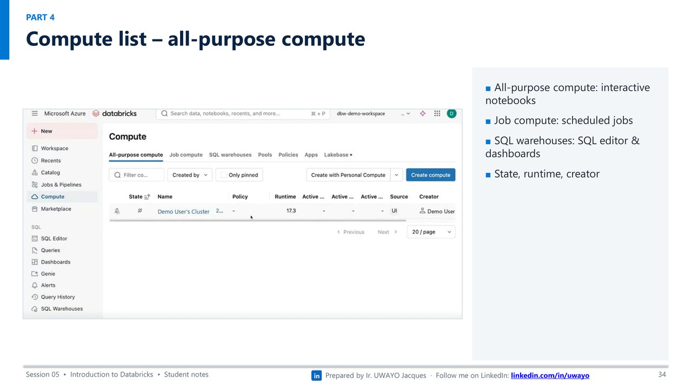

- All-purpose compute: interactive notebooks
- Job compute: scheduled jobs
- SQL warehouses: SQL editor & dashboards
- State, runtime, creator

---

## Slide 35: Free Edition: serverless SQL warehouse

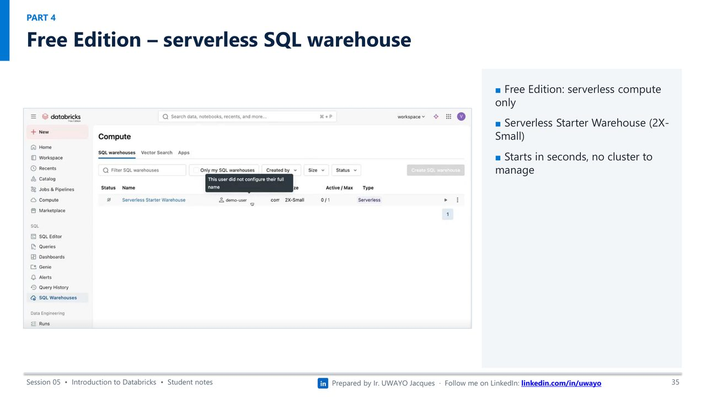

- Free Edition: serverless compute only
- Serverless Starter Warehouse (2X-Small)
- Starts in seconds, no cluster to manage

---

## Slide 36: Compute options at a glance

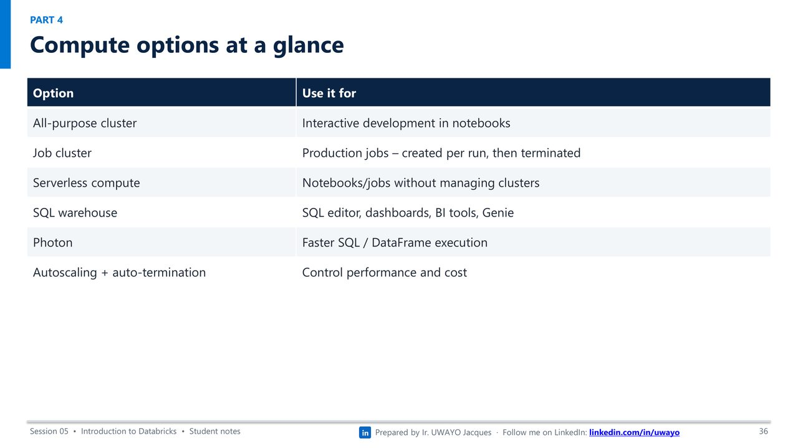

| Option | Use it for |
| --- | --- |
| All-purpose cluster | Interactive development in notebooks |
| Job cluster | Production jobs – created per run, then terminated |
| Serverless compute | Notebooks/jobs without managing clusters |
| SQL warehouse | SQL editor, dashboards, BI tools, Genie |
| Photon | Faster SQL / DataFrame execution |
| Autoscaling + auto-termination | Control performance and cost |

---

## Slide 37: Lab 1: Upload Order.csv to a volume

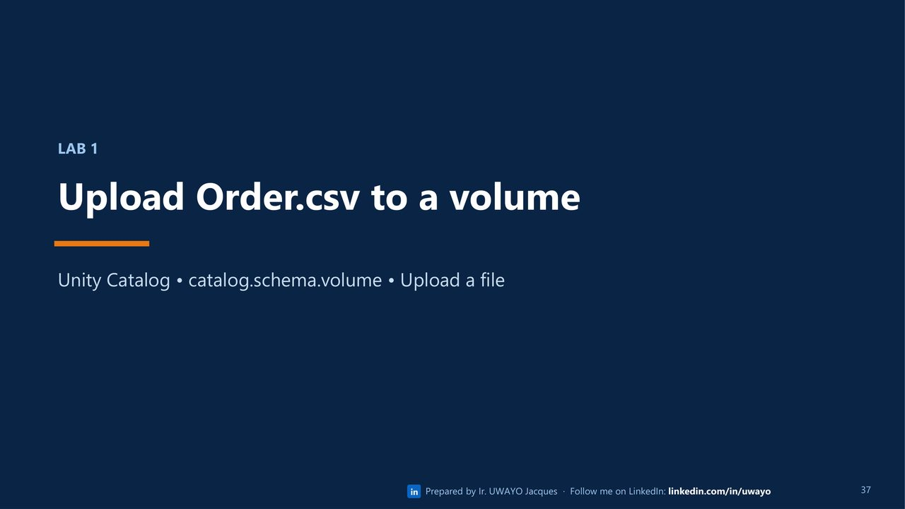

- Unity Catalog • catalog.schema.volume • Upload a file

---

## Slide 38: Today's hands-on flow

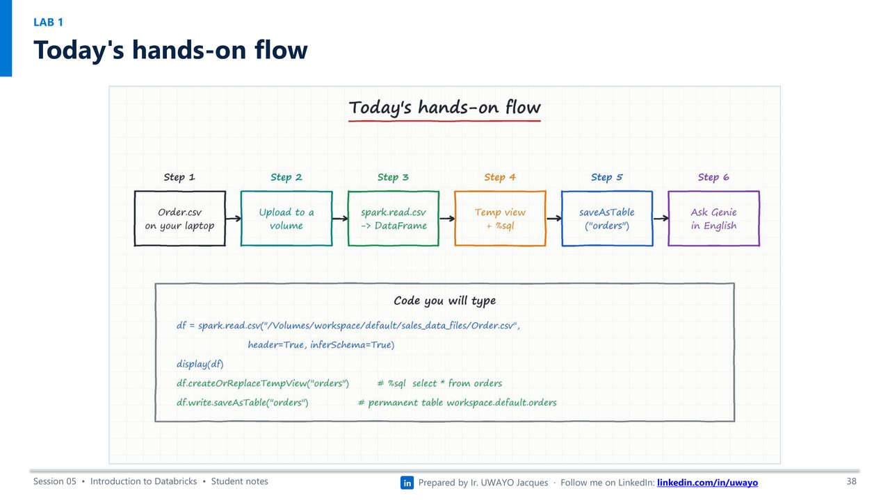

- The five labs follow one file from your laptop to an AI answer: 1. Upload Order.csv to a Unity Catalog volume. 2. Read it into a DataFrame with spark.read.csv. 3. Register a temporary view and query it with %sql; use the AI assistant to write and fix code. 4. Save the DataFrame as a permanent table with saveAsTable and query it in the SQL editor. 5. Create a Genie space on the table and ask questions in plain English.

---

## Slide 39: Unity Catalog: catalog . schema . object

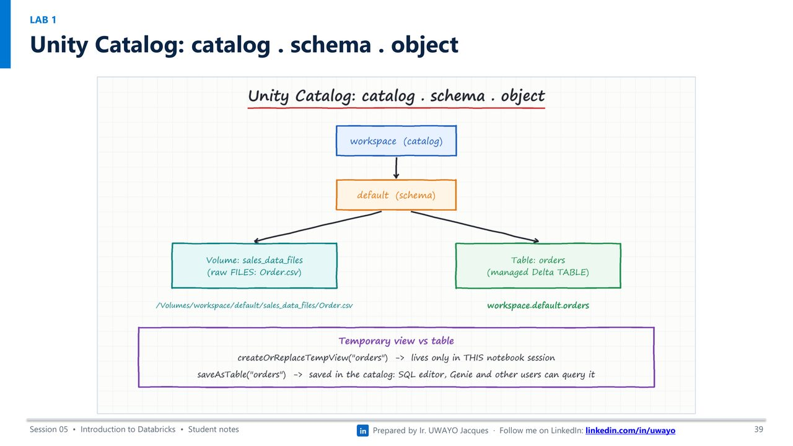

- Unity Catalog is the governance layer of Databricks. Everything is organised in a three-level namespace: catalog.schema.object. • Catalog - top level, for example workspace (created for you in Free Edition). • Schema - a group of objects inside a catalog, for example default. • Objects - tables, views, volumes, functions, models.

---

## Slide 40: New → Add or upload data

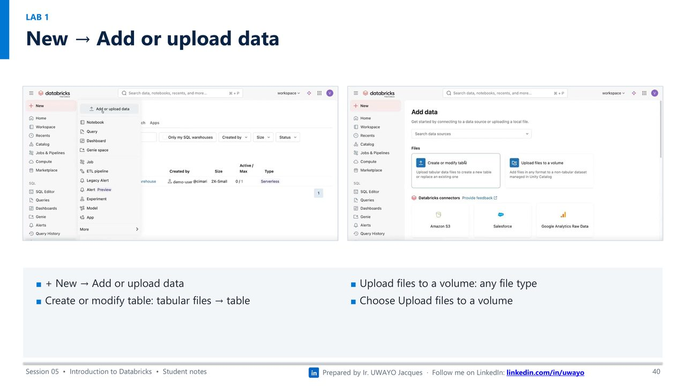

- + New → Add or upload data
- Create or modify table: tabular files → table
- Upload files to a volume: any file type
- Choose Upload files to a volume

---

## Slide 41: Upload files to a volume

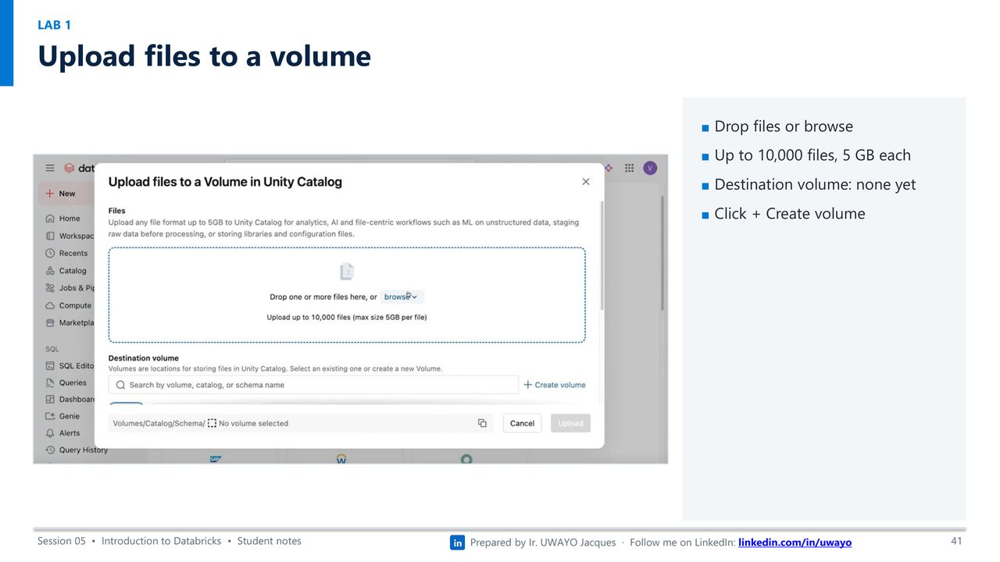

- Drop files or browse
- Up to 10,000 files, 5 GB each
- Destination volume: none yet
- Click + Create volume

---

## Slide 42: Create a new volume

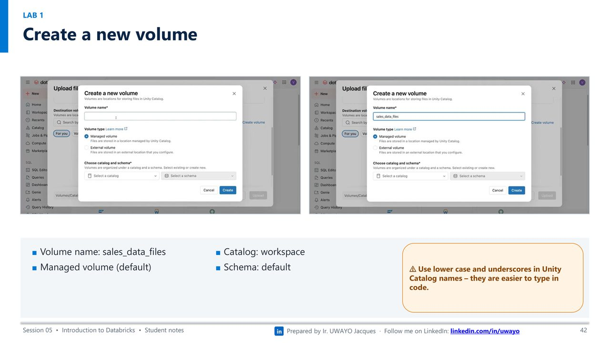

- Volume name: sales_data_files
- Managed volume (default)
- Catalog: workspace
- Schema: default

> **Tip:** Use lower case and underscores in Unity Catalog names – they are easier to type in code.

---

## Slide 43: Choose catalog and schema

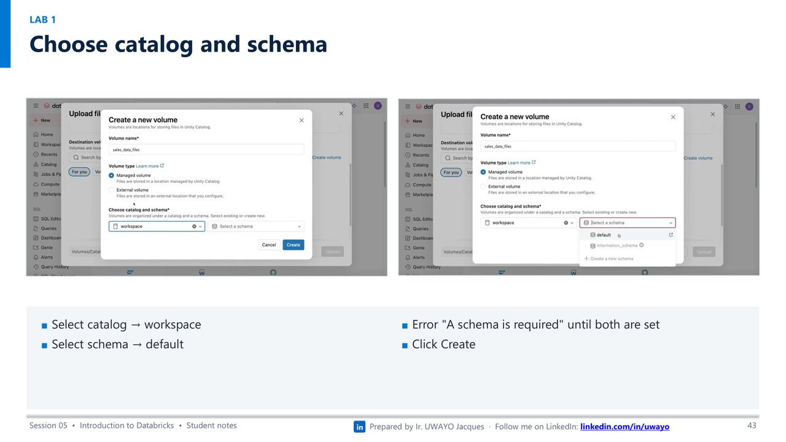

- Select catalog → workspace
- Select schema → default
- Error "A schema is required" until both are set
- Click Create

---

## Slide 44: Volume ready: select the file

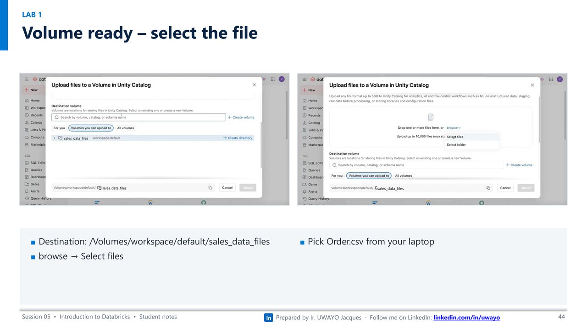

- Destination: /Volumes/workspace/default/sales_data_files
- browse → Select files
- Pick Order.csv from your laptop

---

## Slide 45: Upload Order.csv

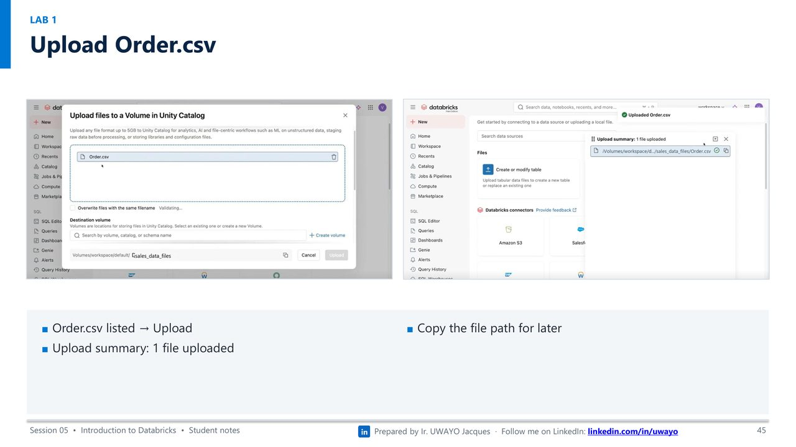

- Order.csv listed → Upload
- Upload summary: 1 file uploaded
- Copy the file path for later

---

## Slide 46: Find the volume in Catalog Explorer

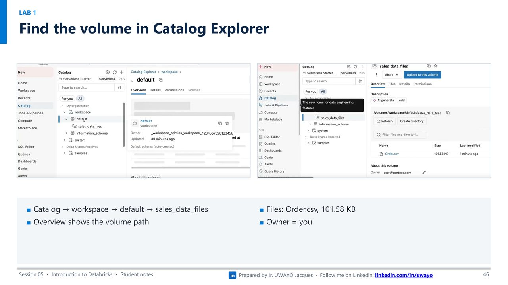

- Catalog → workspace → default → sales_data_files
- Overview shows the volume path
- Files: Order.csv, 101.58 KB
- Owner = you

---

## Slide 47: Preview the file and copy its path

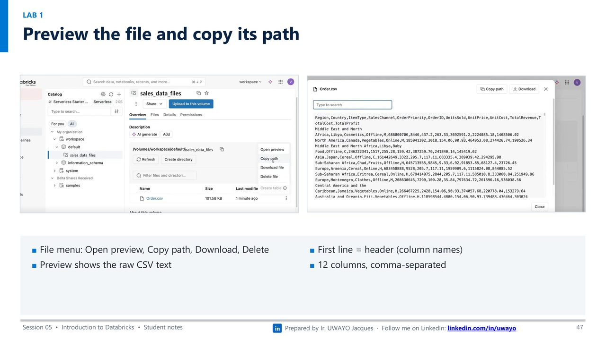

- File menu: Open preview, Copy path, Download, Delete
- Preview shows the raw CSV text
- First line = header (column names)
- 12 columns, comma-separated

---

## Slide 48: Lab 2: Read the CSV with PySpark

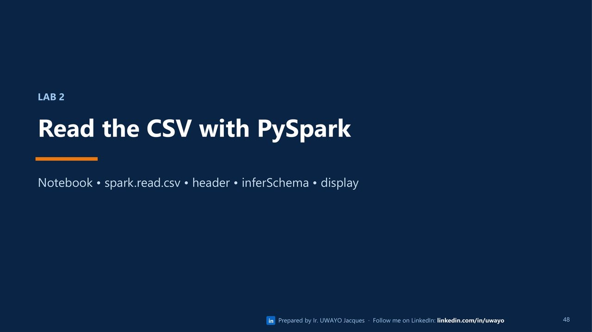

- Notebook • spark.read.csv • header • inferSchema • display

---

## Slide 49: Create a notebook

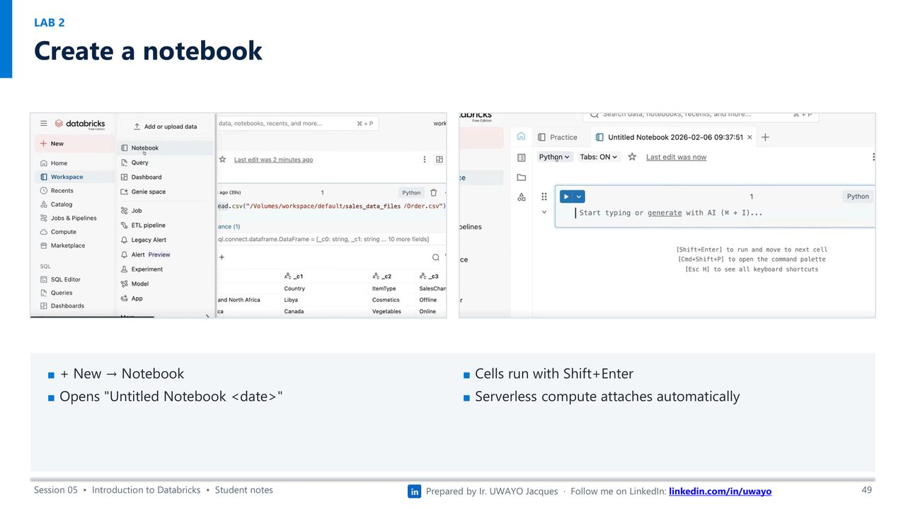

- + New → Notebook
- Opens "Untitled Notebook <date>"
- Cells run with Shift+Enter
- Serverless compute attaches automatically

---

## Slide 50: Default language and notebook name

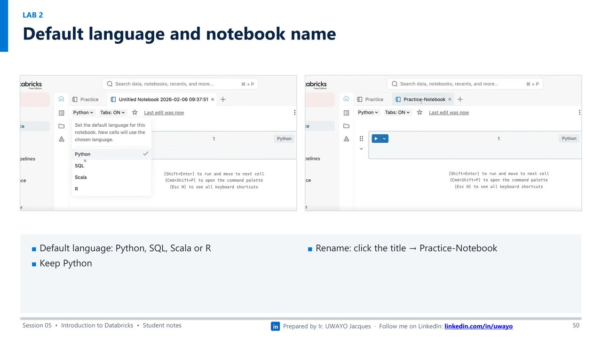

- Default language: Python, SQL, Scala or R
- Keep Python
- Rename: click the title → Practice-Notebook

---

## Slide 51: First read: spark.read.csv(path)

- df = spark.read.csv("/Volumes/.../Order.csv")
- display(df) shows a table
- Columns are _c0, _c1, _c2 …
- Header line appears as row 1!

---

## Slide 52: Fix the header: header=True

- Add header=True
- Column names come from the first line
- Row 1 is now real data

> **Tip:** Python is case-sensitive: header=True works, header=true fails.

---

## Slide 53: Check the schema: everything is a string

- Expand df: pyspark.sql.DataFrame
- Every column is string
- UnitsSold, UnitPrice … should be numbers
- Strings cannot be summed correctly

---

## Slide 54: Detect data types: inferSchema=True

- Add inferSchema=True
- OrderID, UnitsSold → integer
- UnitPrice, TotalRevenue … → double
- Spark reads the data once more to guess types

> **Tip:** Production tip: define the schema yourself (StructType or a DDL string) – faster and safer than inferSchema.

---

## Slide 55: Result table and type icons

- display() = interactive table
- Icons show the type: ABC string, 123 int, 1.2 double
- Hover a column icon to see the type
- Sort, filter, add visualisations with +

---

## Slide 56: Code help: function signature

- Hover a function or press Tab
- Shows all parameters of csv()
- sep, encoding, quote, escape, header, inferSchema …

---

## Slide 57: spark.read.csv: options you will use most

| Option | What it does |
| --- | --- |
| header=True | First line contains the column names |
| inferSchema=True | Detect integer / double / date types |
| sep=";" | Use another separator (default is a comma) |
| schema="OrderID INT, Region STRING …" | Give the types yourself (fast, reliable) |
| nullValue="NA" | Treat a text value as NULL |
| spark.read.format("csv").option(...).load(path) | Same thing, longer syntax |

---

## Slide 58: Lab 3: Spark SQL and the AI assistant

- Temp view • %sql • _sqldf • Generate with AI • Diagnose error

---

## Slide 59: Register a temporary view

- df.createOrReplaceTempView("orders")
- Gives the DataFrame a SQL name
- Lives only in this notebook session

---

## Slide 60: Change a cell to SQL with %sql

- Cell language menu: Markdown, Python, SQL, Scala, R
- Or type %sql on the first line
- Auto-complete helps with keywords

---

## Slide 61: Error: TABLE_OR_VIEW_NOT_FOUND

- The view "orders" cannot be found
- Cause: the createOrReplaceTempView cell was not run
- Fix: run cells in order (cell 2, then cell 3)

> **Tip:** Before you debug the code, check: did I run the cells above?

---

## Slide 62: SQL result: orders from India

- where Country = 'India'
- order by TotalProfit desc limit 10
- Text values in single quotes
- Result is also a DataFrame: _sqldf

---

## Slide 63: Python and SQL work together: _sqldf

- SQL result stored as _sqldf
- Use it in the next Python cell
- Mix languages in one notebook

---

## Slide 64: Generate code with the AI assistant

- In an empty cell: Cmd/Ctrl + I
- Prompt: "I have a csv file orders.csv, read it and display it"
- Review the code → Accept or Reject
- Run suggested

---

## Slide 65: AI code fails: PATH_NOT_FOUND

- The prompt said orders.csv
- The real file is Order.csv
- Paths are case-sensitive and exact
- Fix the file name, run again

> **Tip:** PATH_NOT_FOUND = check spelling, upper/lower case and the volume name in the path.

---

## Slide 66: Typical errors while editing

- SyntaxError: unmatched ')' – an extra bracket
- Fix brackets and quotes, run again
- Working version reads 1,000 rows

---

## Slide 67: Diagnose error with the Assistant

- spark.read.sdfjds(...) → AttributeError
- 'DataFrameReader' has no attribute 'sdfjds'
- Click Diagnose error
- Assistant explains and proposes a fix (/fix)

---

## Slide 68: Accept the fix and run

- Suggested change shown in the cell
- Accept → the Assistant runs the cell
- Result appears again
- Always review AI changes

---

## Slide 69: Lab 4: Create a table in Databricks

- Permissions • SQL editor • saveAsTable • Catalog Explorer

---

## Slide 70: Catalog Explorer and the Create menu

- Suggested: recently used objects
- Create: catalog, volume, external location, credential, connection
- Our volume sales_data_files is listed

---

## Slide 71: Manage permissions on a volume

- Share → Manage permissions
- Permissions tab → Grant
- No permissions granted yet = only the owner

---

## Slide 72: Grant privileges

- Principal: a user, group or All account users
- READ VOLUME / WRITE VOLUME
- ALL PRIVILEGES, MANAGE
- Grant the minimum needed

---

## Slide 73: SQL editor: query the temp view?

- SQL Editor → New query
- select * from orders
- Attach the Serverless Starter Warehouse
- Start, attach and run

---

## Slide 74: TABLE_OR_VIEW_NOT_FOUND in the SQL editor

- orders works in the notebook, not here
- A temp view lives only in its notebook session
- Other tools need a real table

---

## Slide 75: Save the DataFrame as a table

- df.write.saveAsTable("orders")
- Creates workspace.default.orders
- Managed Delta table
- Optional: format, mode, partitionBy

> **Tip:** Run saveAsTable twice and it fails ("table already exists") – use df.write.mode("overwrite").saveAsTable("orders").

---

## Slide 76: Query the new table with %sql

- %sql select * from orders
- Now reads the TABLE (not the view)
- 1,000 rows

---

## Slide 77: The table in Catalog Explorer

- workspace → default → Tables (1) → orders
- Owner, created date
- Volumes (1) next to Tables (1)

---

## Slide 78: Table overview, AI description and sample data

- AI Suggested Description → Accept or Edit
- Columns and types
- Sample Data tab
- Ask questions about the sample data

---

## Slide 79: SQL editor: now it works

- select * from orders
- 1,000 rows in 0.66 s
- Same table for notebooks, SQL, dashboards, Genie

---

## Slide 80: Lab 5: Genie in Databricks

- Ask your data questions in natural language

---

## Slide 81: What is Genie?

- Genie (AI/BI Genie) lets business users ask questions about data in plain English. A Genie space is connected to one or more tables. When you ask a question, Genie writes a SQL query, runs it on a SQL warehouse and shows the answer as text and a table, plus the SQL it used.

---

## Slide 82: Create a Genie space

- Genie → + New
- Connect your data: choose orders
- Create

---

## Slide 83: The Genie space

- Data: orders (Table)
- Suggested questions
- Configure: instructions, settings
- Type your question

---

## Slide 84: Genie thinks step by step

- Drafts a step-by-step plan
- Finds the relevant data: orders
- Counts orders per country, sorts, takes the top

---

## Slide 85: Answer + generated SQL

- Answer: Cuba, 11 orders
- Show code → the SQL Genie wrote
- COUNT(OrderID) … GROUP BY … ORDER BY … LIMIT
- Is this correct? Yes / Fix it

> **Tip:** Genie can be wrong. Read the SQL before you trust the number.

---

## Slide 86: More questions

- Which region has the most orders? → Europe, 267
- Biggest order? → TotalRevenue 6,617,209.54
- Follow-up suggestions appear

---

## Slide 87: Check the SQL and give feedback

- SELECT TotalRevenue … ORDER BY TotalRevenue DESC LIMIT 1
- Was this correct?
- Benchmarks and Monitoring
- Always review the accuracy of responses

---

## Slide 88: Wrap-up: troubleshooting, Q&A, homework

- Errors we met • FAQ • Quiz • Homework • Next session

---

## Slide 89: Troubleshooting: errors from today

| Error | Cause → fix |
| --- | --- |
| Columns _c0, _c1 … | No header option → header=True |
| All columns are string | No type detection → inferSchema=True or a schema |
| TABLE_OR_VIEW_NOT_FOUND (notebook) | Temp-view cell not run → run cells in order |
| TABLE_OR_VIEW_NOT_FOUND (SQL editor) | Temp view is session-only → saveAsTable |
| PATH_NOT_FOUND | Wrong file name / case → copy the path |
| SyntaxError: unmatched ')' | Extra bracket or quote → fix syntax |
| AttributeError … no attribute | Wrong method name → check spelling / Diagnose error |
| Not enough CPU cores (quota) | Fewer workers or request a quota increase |

---

## Slide 90: Frequently asked questions (1/2)

| Question | Short answer |
| --- | --- |
| Is Databricks free? | Free Edition is free for learning; Azure Databricks is pay-per-use (DBU + VMs). |
| Do I need to learn Scala? | No – PySpark and SQL cover most data engineering jobs. |
| Spark or pandas? | pandas = one machine; Spark = a cluster. Use Spark for big data. |
| What is a DBU? | Databricks Unit – the billing unit per hour of compute. |
| Databricks or ADF? | Both: ADF orchestrates and copies, Databricks transforms. |
| What format is a Databricks table? | Delta Lake (Parquet files + transaction log) by default. |

---

## Slide 91: Frequently asked questions (2/2)

| Question | Short answer |
| --- | --- |
| Volume or table? | Volume for files, table for queryable data. |
| Managed vs external? | Managed: Databricks controls storage. External: your own ADLS path. |
| Can Databricks read our ADLS files? | Yes – via an external location / storage credential (later session). |
| Can ADF run a notebook? | Yes – the Databricks Notebook activity in a pipeline. |
| Is Genie always correct? | No – check the SQL, add instructions and benchmarks. |
| Is Free Edition enough for interviews? | Yes for practice; learn cluster settings from Azure docs too. |

---

## Slide 92: Quick quiz

| Question | Answer |
| --- | --- |
| Which V means "data arrives very fast"? | Velocity |
| Spark is written in … | Scala (runs on the JVM) |
| PySpark is … | The Python API for Spark |
| Option that uses the first line as column names? | header=True |
| Option that detects integer / double types? | inferSchema=True |
| Why did the SQL editor not find "orders"? | It was only a temporary view |
| Command that creates a permanent table? | df.write.saveAsTable("orders") |
| Three-level name of the table? | workspace.default.orders |

---

## Slide 93: Homework / practice

- Create your own Free Edition workspace and rebuild Labs 1–5
- Total revenue per Region and per ItemType with %sql (group by)
- Read the file with an explicit schema instead of inferSchema
- Save a table orders_india with only Indian orders (mode overwrite)
- Ask Genie 3 new questions and check the SQL each time
- Bonus: upload a JSON file and read it with spark.read.json

---

## Slide 94: Key takeaways

- Big data = too big / fast / varied for one machine → distributed processing
- Spark = engine, PySpark = Python API, Databricks = managed platform
- Volumes hold files; tables hold data (Delta) – catalog.schema.object
- header=True + inferSchema=True (or a schema) for CSV
- Temp views are session-only; saveAsTable shares data
- Genie answers in English – always check the SQL

---

## Slide 95: Thank you

- Questions?  ·  Rebuild the labs in Free Edition  ·  Bring your Q&A

---

 **Prepared by Ir. UWAYO Jacques** · [Follow me on LinkedIn](https://www.linkedin.com/in/uwayo/)
