# Session 5: Databricks (Study guide)

<a href="https://www.linkedin.com/in/uwayo/"></a> **Prepared by Ir. UWAYO Jacques** · [Follow me on LinkedIn](https://www.linkedin.com/in/uwayo/)

**What you will learn:** You will learn what **big data** is and why it needs a **cluster**, the three **types of data**, and the difference between **Spark**, **PySpark** and **Databricks**. You will see how a workspace is created in Azure, then create your own free **Databricks Free Edition** account. In five labs you upload a CSV file to a **Unity Catalog volume**, read it with **PySpark**, query it with **Spark SQL**, save it as a **table**, and ask questions about it in plain English with **Genie**.

**Before you start:** A web browser and an email address you can open during the session. No Azure subscription or credit card is needed for the labs. Download the sample file [Order.csv](Order.csv) (1,000 sales orders, 12 columns).

**Slides:** [slides.md](slides.md) · [Download the slides as PDF](slides.pdf)

> **Names used in this guide**
>
> The screenshots use example names. Use your own where it makes sense; if you keep the names below, the code in this guide works exactly as written.
>
> | Item | Name in this guide | Created in |
> | --- | --- | --- |
> | Azure Databricks workspace (screenshots only) | `dbw-demo-workspace` | Demo |
> | Catalog / schema | `workspace` / `default` | Created for you in Free Edition |
> | Volume | `sales_data_files` | Lab 1 |
> | File | `Order.csv` | Lab 1 |
> | Notebook | `Practice-Notebook` | Lab 2 |
> | Temporary view | `orders` | Lab 3 |
> | Table | `workspace.default.orders` | Lab 4 |
> | Genie space | `New Space` | Lab 5 |

## Recap: where Databricks fits

In Sessions 2 to 4 you built the **ingestion** side of a data platform: Azure Data Factory copied tables from Azure SQL Database into ADLS Gen2 as CSV, JSON and Parquet files.

- **Sources:** business applications such as HR, CRM, SQL databases and web analytics.
- **Azure Data Factory:** copies and orchestrates (Sessions 2 to 4).
- **ADLS Gen2:** the data lake that stores the raw files.
- **Databricks:** the **processing** layer. It reads the files, cleans and transforms them with Spark, and writes curated tables.

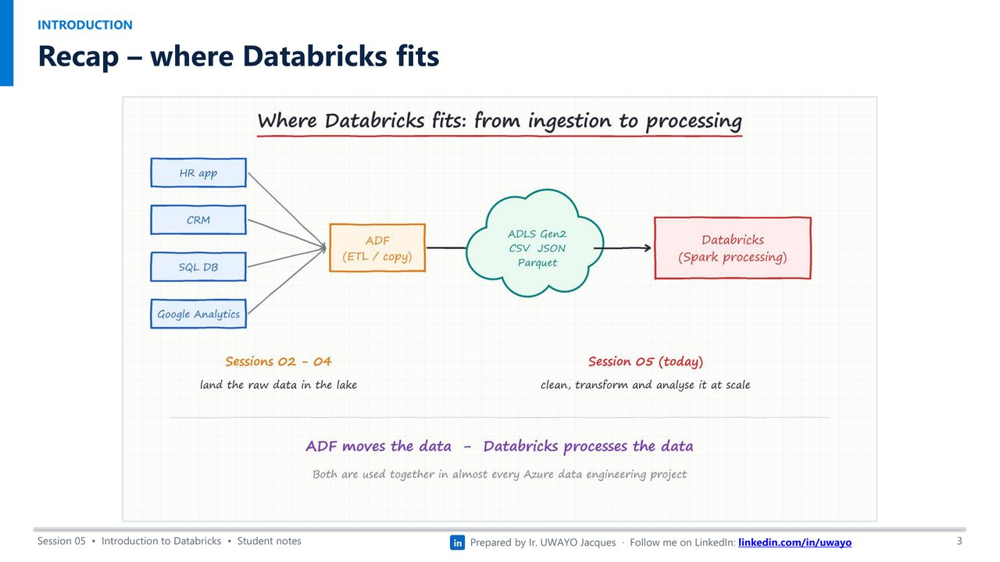

### Why this session matters

Business users do not want files; they want clean tables, totals per region and dashboards. For that you need an engine that reads millions of rows, transforms them and grows when the data grows. On Azure that engine is very often **Azure Databricks**, and Spark / PySpark questions appear in almost every data engineering interview.

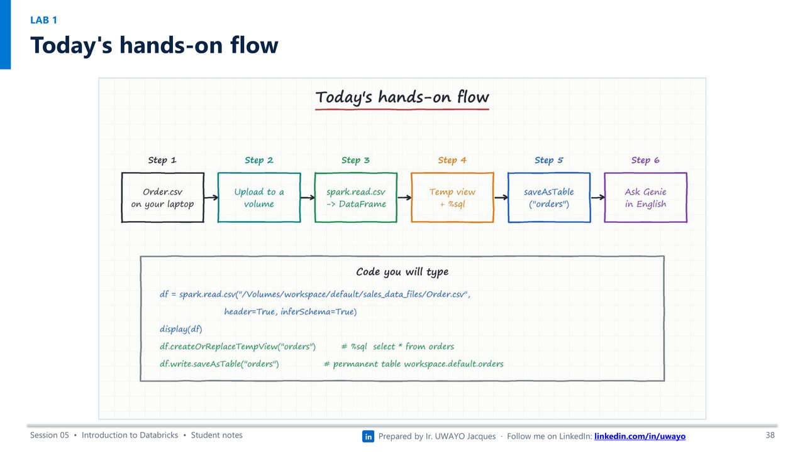

## 1. Big data and types of data

### The 5 Vs

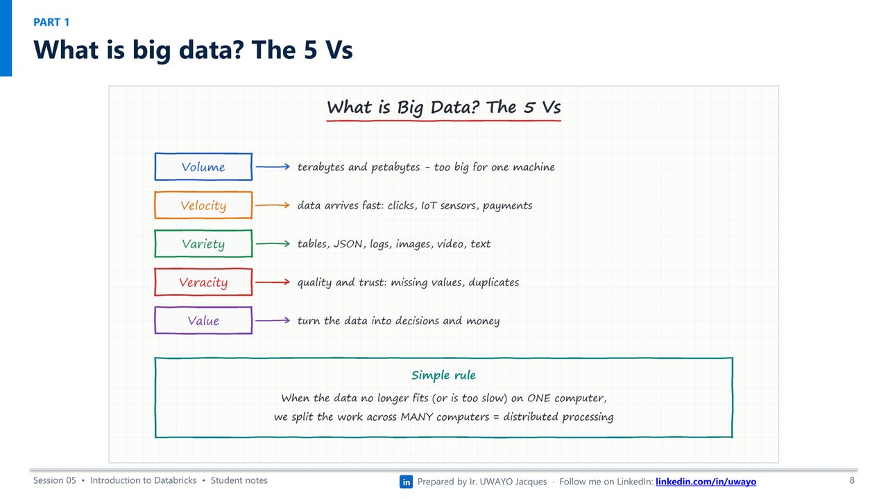

| V | Meaning | Example |
| --- | --- | --- |
| **Volume** | The amount of data | Terabytes of orders and logs over years |
| **Velocity** | The speed at which data arrives | Card payments, clicks, IoT sensors every second |
| **Variety** | The different shapes of data | Tables, JSON, logs, images, video, text |
| **Veracity** | How trustworthy the data is | Missing values, duplicates, wrong formats |
| **Value** | The business benefit | Fraud detection, recommendations, better decisions |

**The practical rule:** when data no longer fits on one machine, or one machine is too slow, you split the work across many machines. That is **distributed processing**, and it is exactly what Spark does.

### Scaling out: one driver, many workers

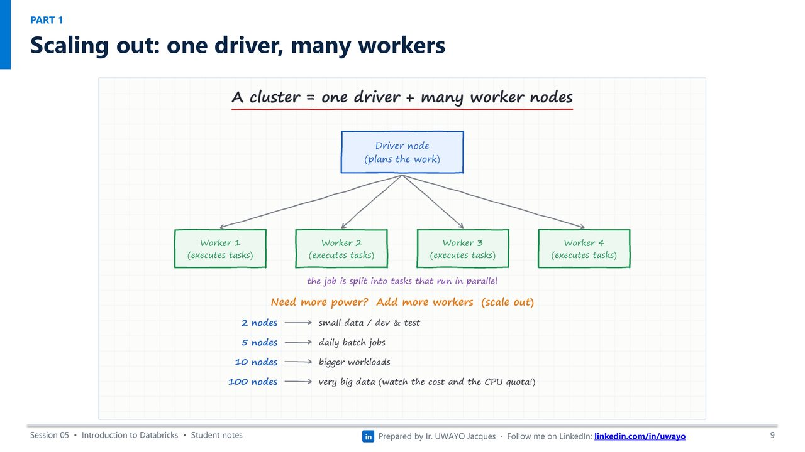

- **Scale up** means buying one bigger machine. It has a limit and gets expensive.
- **Scale out** means adding more ordinary machines that work together.

A Spark **cluster** has one **driver** node, which receives your code, plans the job and splits it into tasks, and several **worker** nodes, which run the tasks in parallel, each on a part of the data (a **partition**). More workers make the job faster, but they also cost more, and your Azure subscription has a CPU quota.

### Types of data

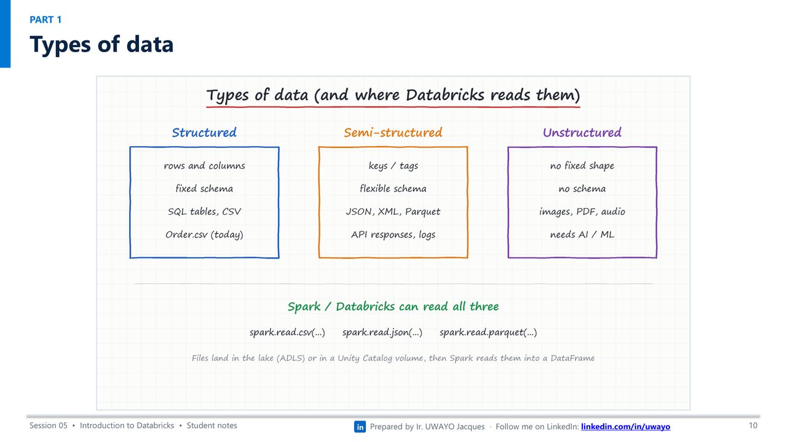

| Type | What it is | Examples |
| --- | --- | --- |
| **Structured** | A fixed schema of rows and columns | SQL tables, CSV files (today's `Order.csv`) |
| **Semi-structured** | Carries its structure with keys or tags; the schema can vary | JSON, XML, API responses, logs |
| **Unstructured** | No schema; needs AI or ML to extract value | Images, PDF documents, audio, video |

Spark reads all three with the same API: `spark.read.csv()`, `spark.read.json()`, `spark.read.parquet()`. The result is a **DataFrame**: a distributed table with named, typed columns.

### Vocabulary

| Term | Meaning |
| --- | --- |
| Cluster | A group of machines (nodes) that work together |
| Driver / worker | The node that plans the work / the nodes that execute it |
| Partition | A piece of the data processed by one task |
| DataFrame | A distributed table with named, typed columns |
| Batch / streaming | Process data in chunks on a schedule / continuously as it arrives |
| Lakehouse | A data lake plus table features (Delta Lake): ACID, SQL, governance |

## 2. Spark vs PySpark vs Databricks

### Apache Spark

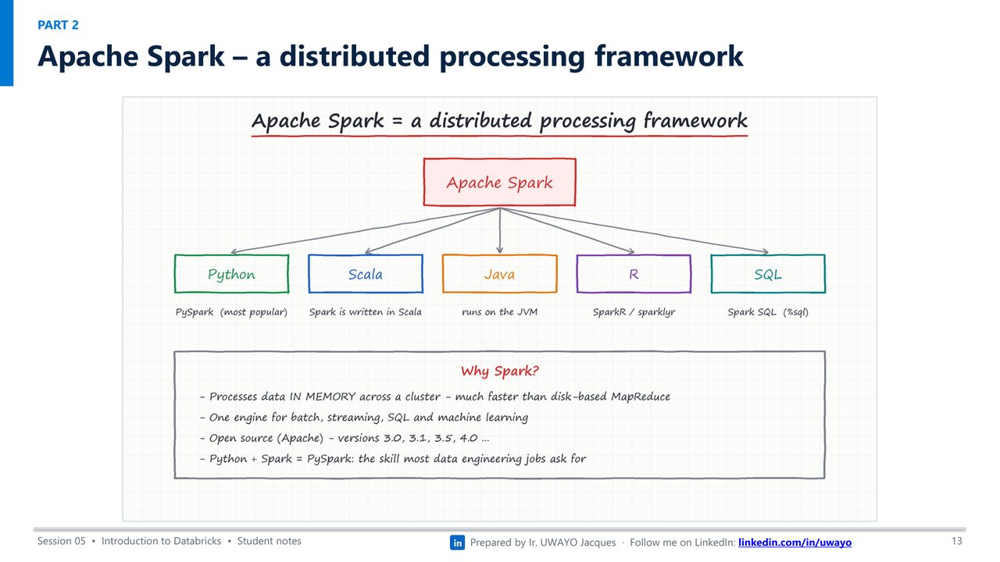

**Apache Spark** is an open-source framework for processing large amounts of data on a cluster. It keeps data **in memory** between steps, which makes it much faster than the older Hadoop MapReduce. One engine covers batch, streaming, SQL and machine learning. Spark has APIs in several languages:

- **Python:** PySpark, the most popular today.
- **Scala:** the language Spark itself is written in.
- **Java:** runs on the same JVM.
- **R:** SparkR / sparklyr.
- **SQL:** Spark SQL, the `%sql` cells in a Databricks notebook.

### How PySpark talks to Spark

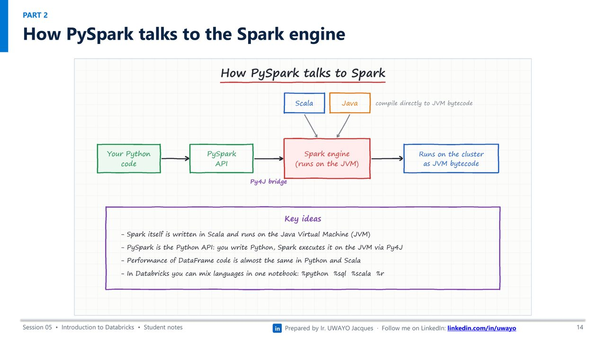

Spark runs on the **Java Virtual Machine (JVM)**. Scala and Java compile directly to JVM bytecode. **PySpark** sends your Python instructions to the engine through a bridge called **Py4J**. The heavy work (reading, filtering, joining, aggregating) is done by the engine on the cluster, so DataFrame code in Python is almost as fast as in Scala.

### Spark vs PySpark vs Databricks

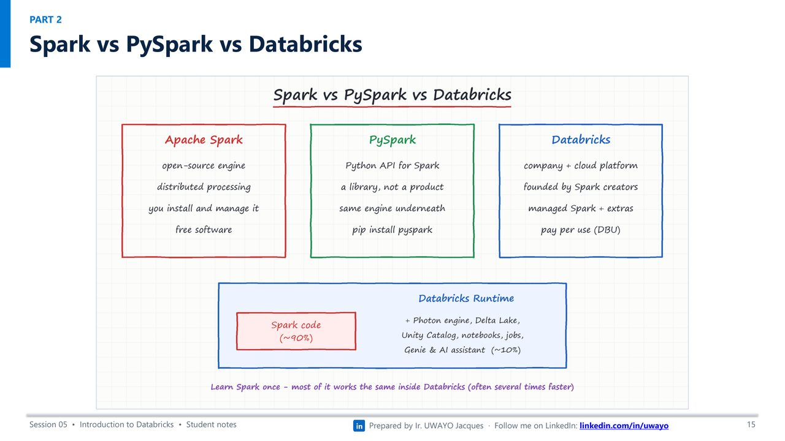

| | What it is |
| --- | --- |
| **Apache Spark** | The open-source processing engine. You can install it yourself and manage the servers. |
| **PySpark** | The Python API for Spark (`pip install pyspark`). A library, not a separate engine. |
| **Spark SQL** | The SQL API for Spark. |
| **Databricks (company)** | Founded by the original creators of Spark. |
| **Databricks (platform)** | Managed Spark plus the Databricks Runtime and Photon engine, Delta Lake, Unity Catalog, notebooks, jobs, SQL warehouses and Genie. |
| **Azure Databricks** | Databricks offered as a first-party Azure service. |

A useful way to remember it: Databricks is about **90% Spark knowledge plus 10% Databricks-specific features**. If you learn Spark well, you can also work in Microsoft Fabric, Synapse Spark or AWS EMR.

### Databricks on every cloud

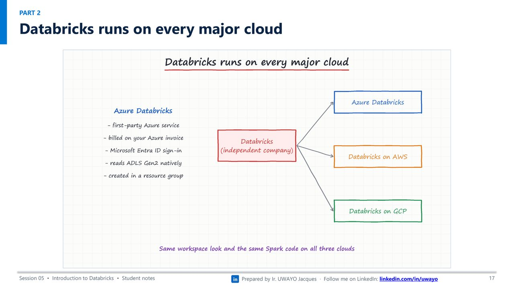

Databricks runs on Azure, AWS and Google Cloud with the same workspace and the same code. **Azure Databricks** is created in the Azure portal inside a resource group, billed on your Azure invoice, uses Microsoft Entra ID for sign-in, and reads ADLS Gen2 natively.

## 3. Create a Databricks account

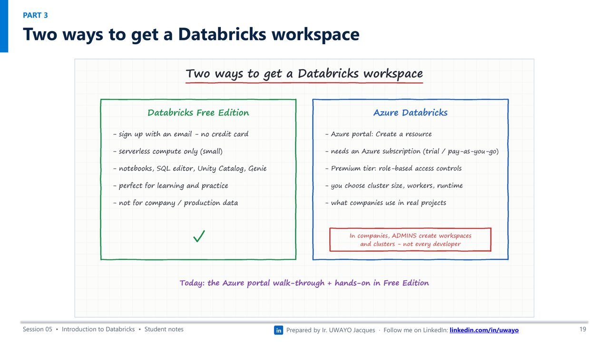

| | Databricks Free Edition | Azure Databricks |
| --- | --- | --- |
| Cost | Free, no credit card | Pay per use: DBUs plus the Azure virtual machines |
| Created from | The Databricks website | The Azure portal, in your subscription |
| Compute | Serverless only (small) | You choose runtime, worker type and number of workers |
| Use it for | Learning and practice | Real company projects |

> **Note**
>
> In companies, workspaces and clusters are usually created by **admins** or the platform team. As a data engineer you normally receive access to an existing workspace and a cluster policy. You still need to understand the options for interviews.

### Azure Databricks (look, do not create)

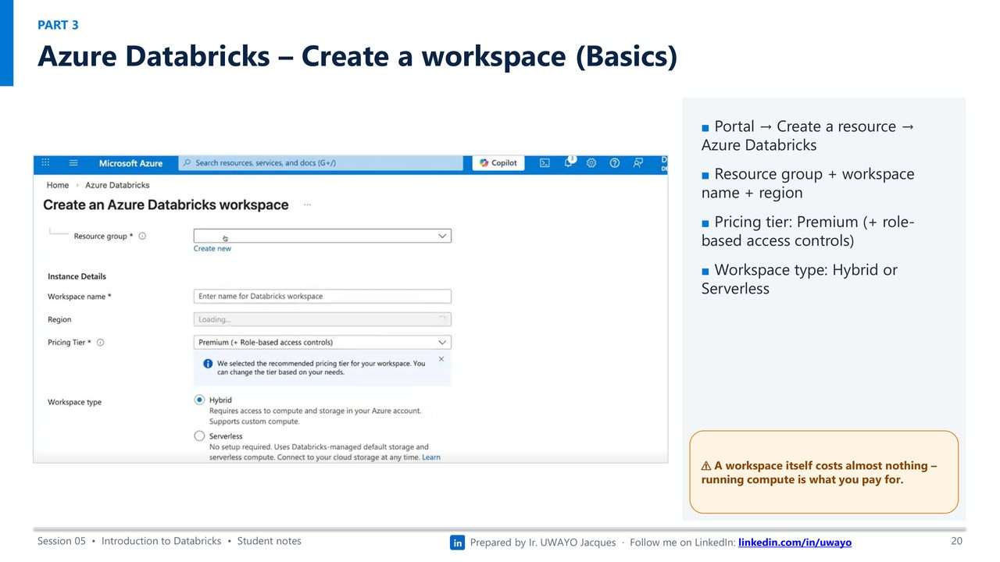

In the Azure portal search for **Azure Databricks** and select **Create**:

| Setting | Value |
| --- | --- |
| Resource group | Your resource group |
| Workspace name | A unique name, for example `dbw-demo-workspace` |
| Region | The same region as your storage account |
| Pricing tier | **Premium** (role-based access controls, Unity Catalog features) |
| Workspace type | **Hybrid** (compute and storage in your Azure account) or **Serverless** (Databricks-managed) |
| Networking | Secure Cluster Connectivity (No Public IP): **Yes**. Deploy in your own VNet: **No** for learning |

> **Warning**
>
> The workspace itself costs almost nothing, but running clusters costs money. Do not create a paid workspace just to practise; use Free Edition.

### Lab 0: create your Free Edition account

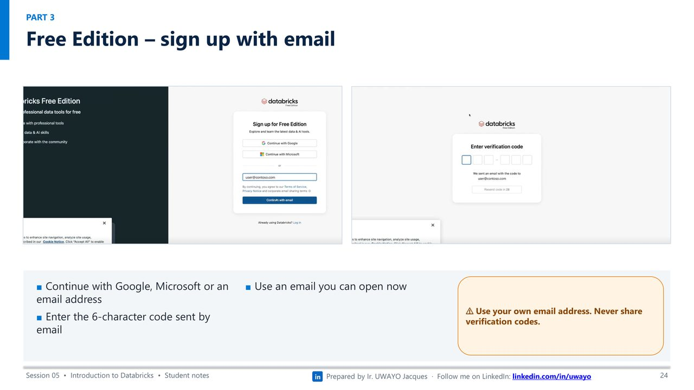

1. Search for **Databricks Free Edition** and open the Free Edition page.
2. Select **Sign up for Free Edition**.
3. Choose **Continue with Google**, **Continue with Microsoft**, or type your email and select **Continue with email**.
4. Open your mailbox and type the verification code. Use **Resend code** if it expires.
5. Name your account, choose your country and select **Continue**. Solve the puzzle if one appears.
6. Wait for **Setting up your account / Launching workspace**.

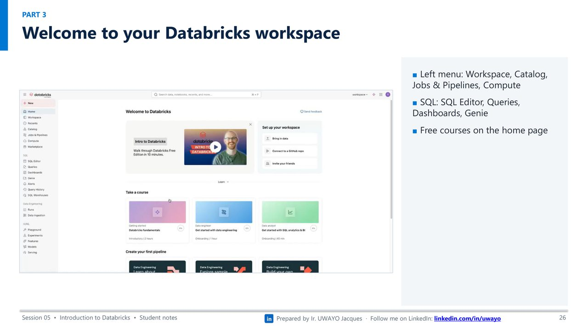

The left menu groups the features:

- **Workspace:** folders and notebooks. Your home folder is `Workspace / Users / <your email>`.
- **Catalog:** Unity Catalog (catalogs, schemas, tables, volumes).
- **Jobs & Pipelines:** scheduled jobs and ETL pipelines.
- **Compute:** clusters and SQL warehouses.
- **SQL Editor, Queries, Dashboards, Genie, Alerts:** analytics.

## 4. Compute: clusters and SQL warehouses

These screens come from an Azure Databricks workspace. Free Edition has only serverless compute, so there is nothing to configure there.

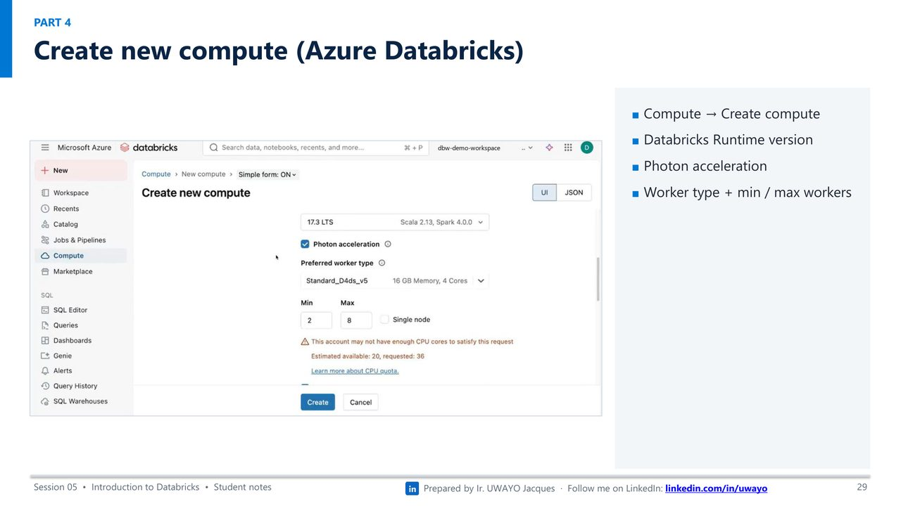

| Setting | What it means |
| --- | --- |
| **Databricks Runtime** | The Spark and Scala version plus Databricks libraries. For example 17.3 LTS = Spark 4.0.0, 16.4 LTS = Spark 3.5.2. Prefer **LTS** (long-term support) for production. |
| **Photon acceleration** | The Databricks C++ engine that speeds up SQL and DataFrame work |
| **Worker type** | The Azure VM size, for example `Standard_D4ds_v5` (16 GB memory, 4 cores) |
| **Min / Max workers** | The autoscaling range, for example 2 to 8 |
| **Enable autoscaling** | Add workers when the job needs them, remove them when idle |
| **Terminate after N minutes of inactivity** | Stops the cluster automatically: the most important cost setting |
| **Policy** | Limits what users can choose. *Unrestricted* means no limits. |
| **Summary** | Total memory and cores, and the price in **DBU/h** (Databricks Units per hour) |

### CPU quota

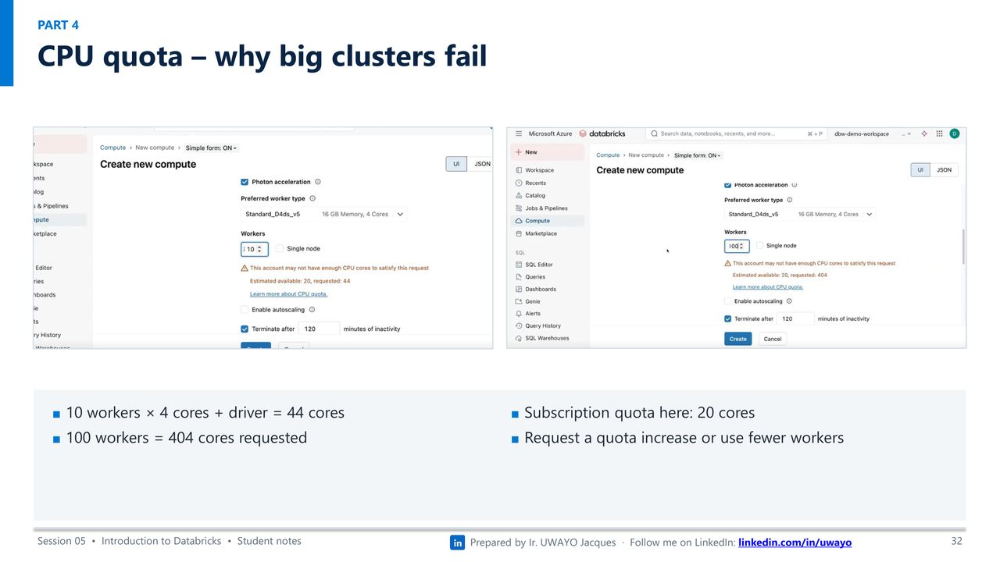

Each `Standard_D4ds_v5` worker has 4 cores. With 10 workers plus the driver the cluster needs **44 cores**; with 100 workers, **404 cores**. If the subscription quota is only 20 cores, you get *This account may not have enough CPU cores to satisfy this request*. Use fewer or smaller workers, or request a quota increase in the Azure portal (**Subscriptions → Usage + quotas**).

### Compute types

| Option | Use it for |
| --- | --- |
| All-purpose compute | Interactive development in notebooks |
| Job compute | Production jobs: created for a run, then terminated |
| Serverless compute | Notebooks and jobs without managing clusters |
| SQL warehouse | The SQL editor, dashboards, BI tools and Genie |

In Free Edition, notebooks run on serverless compute and SQL runs on the **Serverless Starter Warehouse** (2X-Small).

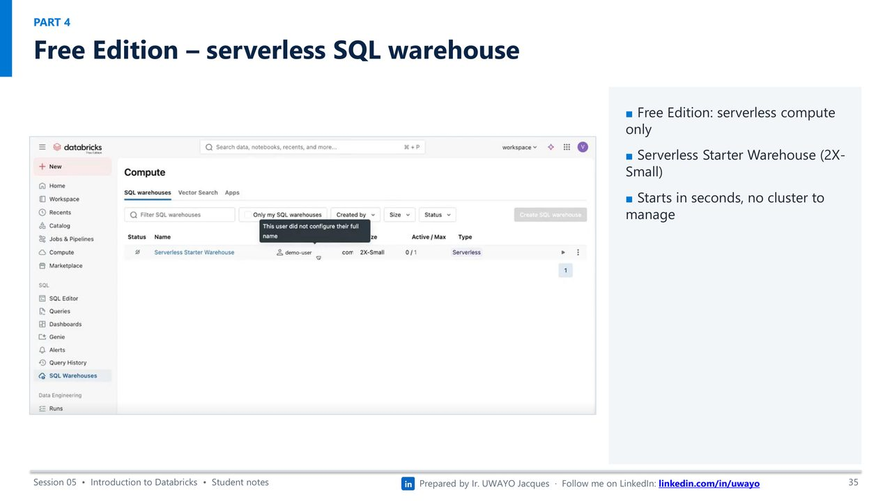

## 5. Lab 1: upload Order.csv to a volume

### Unity Catalog in one picture

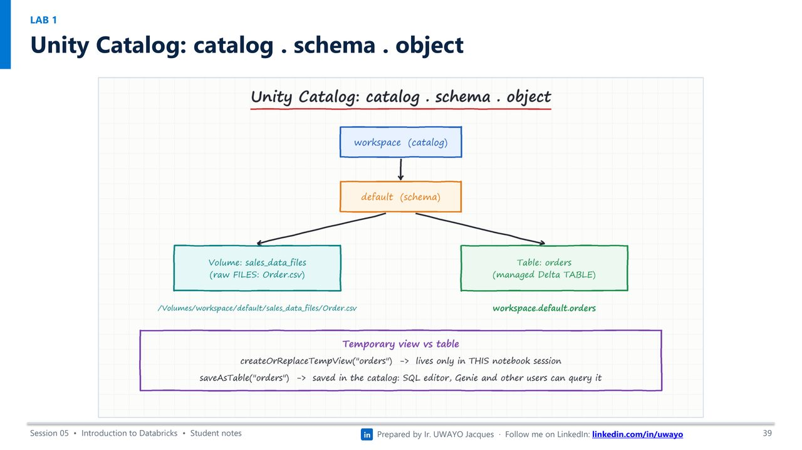

Unity Catalog organises everything as **catalog.schema.object**:

- **Catalog:** the top level, for example `workspace`.
- **Schema:** a group of objects, for example `default`.
- **Objects:** tables, views, volumes, functions and models.

A **volume** stores **files** and is reached with a path: `/Volumes/<catalog>/<schema>/<volume>/<file>`. A **table** stores **data** in Delta format and is queried with SQL: `workspace.default.orders`.

### Steps

1. Select **+ New → Add or upload data**, then **Upload files to a volume**.
   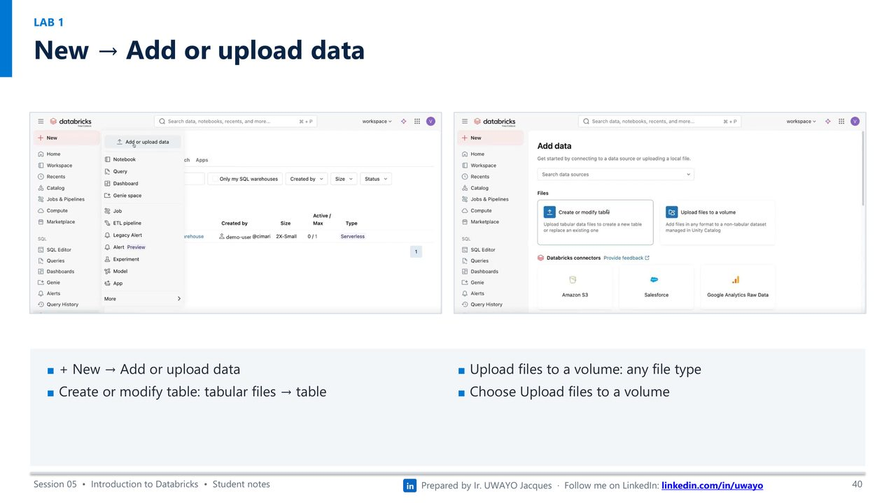
2. There is no destination volume yet, so select **+ Create volume**.
3. Fill in the volume:

   | Setting | Value |
   | --- | --- |
   | Volume name | `sales_data_files` |
   | Volume type | **Managed** (Databricks manages the storage). *External* uses your own storage location. |
   | Catalog | `workspace` |
   | Schema | `default` |

   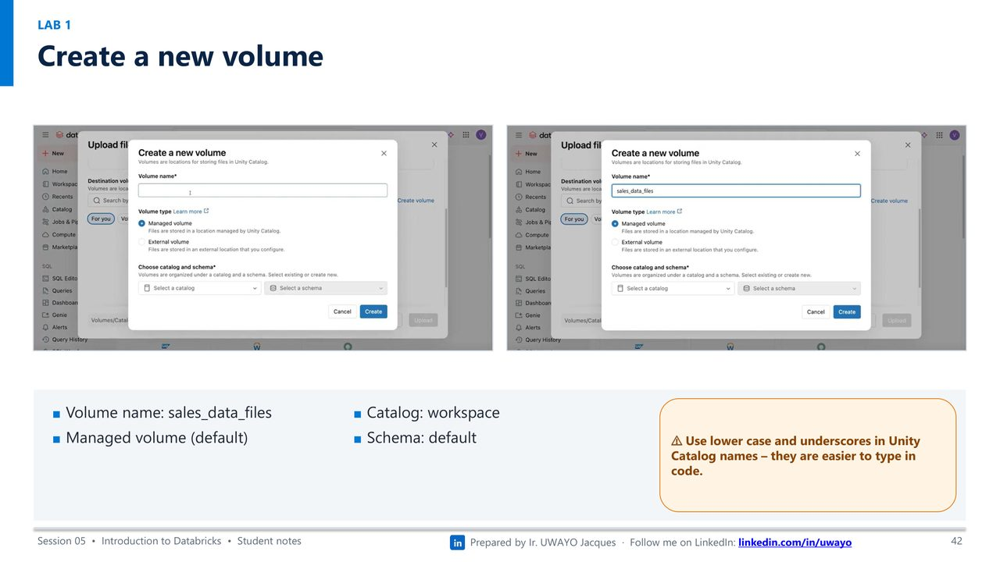
4. Select **Create**. The error *A schema is required* disappears once both catalog and schema are chosen.
5. Select **browse → Select files**, choose `Order.csv` and select **Upload**.
6. The upload summary shows *1 file uploaded*. Copy the path:

   ```text
   /Volumes/workspace/default/sales_data_files/Order.csv
   ```

   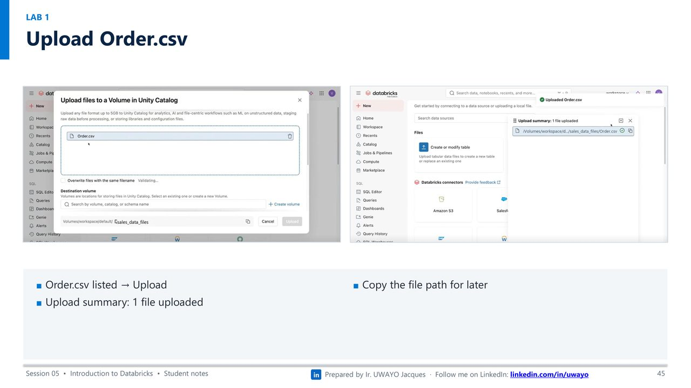

### Validate

Open **Catalog → workspace → default → sales_data_files**. You should see `Order.csv` (about 100 KB). Open the preview: the first line holds the column names (`Region, Country, ItemType, SalesChannel, OrderPriority, OrderID, UnitsSold, UnitPrice, UnitCost, TotalRevenue, TotalCost, TotalProfit`), and each following line is one order.

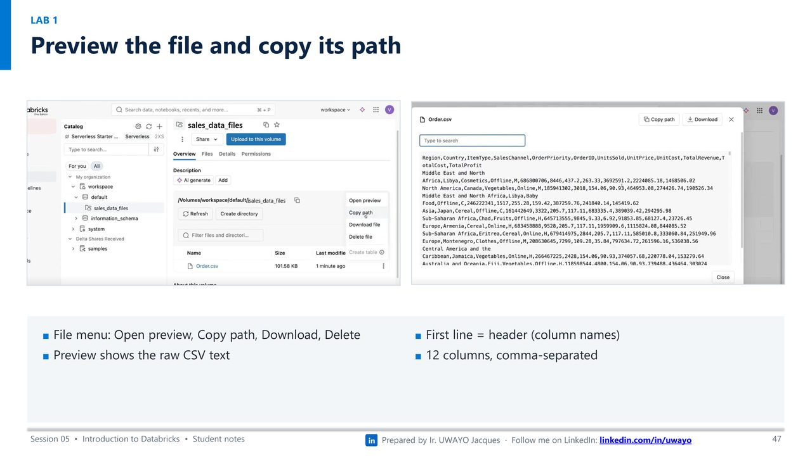

> **Tip**
>
> Use lower case and underscores in Unity Catalog names, and copy paths from Catalog Explorer instead of typing them.

## 6. Lab 2: read the CSV with PySpark

### Step 1: create a notebook

1. Select **+ New → Notebook**.
2. Keep **Python** as the default language.
3. Select the title and rename the notebook `Practice-Notebook`.

Run a cell with **Shift+Enter**. In Free Edition the notebook attaches to serverless compute automatically.

### Step 2: first read

```python
df = spark.read.csv("/Volumes/workspace/default/sales_data_files/Order.csv")
display(df)
```

`spark` is the SparkSession, already created in every Databricks notebook. `display()` shows the DataFrame as an interactive table.

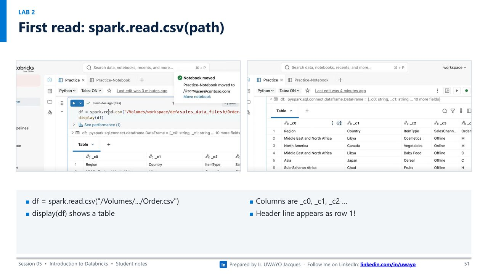

**What is wrong?** The columns are named `_c0`, `_c1`, `_c2` … and the first row contains `Region, Country, ItemType`. By default Spark does **not** use the first line as a header.

### Step 3: use the header

```python
df = spark.read.csv("/Volumes/workspace/default/sales_data_files/Order.csv",
                    header=True)
display(df)
```

Expand `df` under the cell: every column is a **string**, even `UnitsSold` and `TotalRevenue`. You cannot sum strings correctly, and `'9'` sorts after `'10'`.

### Step 4: detect the data types

```python
df = spark.read.csv("/Volumes/workspace/default/sales_data_files/Order.csv",
                    header=True, inferSchema=True)
display(df)
```

Now `OrderID` and `UnitsSold` are **integer**, and `UnitPrice`, `UnitCost`, `TotalRevenue`, `TotalCost` and `TotalProfit` are **double**. The column icons show the type: `ABC` string, `123` integer, `1.2` decimal.

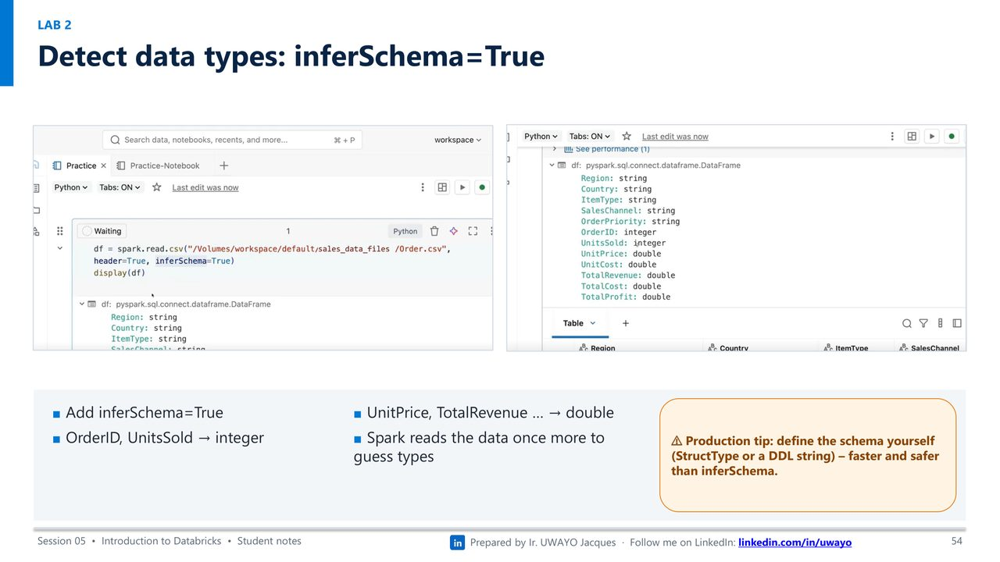

> **Tip**
>
> `inferSchema` reads the data an extra time to guess the types. On large files, define the schema yourself; it is faster and safer:
>
> ```python
> schema = ("Region STRING, Country STRING, ItemType STRING, SalesChannel STRING, "
>           "OrderPriority STRING, OrderID INT, UnitsSold INT, UnitPrice DOUBLE, "
>           "UnitCost DOUBLE, TotalRevenue DOUBLE, TotalCost DOUBLE, TotalProfit DOUBLE")
> df = spark.read.csv("/Volumes/workspace/default/sales_data_files/Order.csv",
>                     header=True, schema=schema)
> ```

### Options you will use most

| Option | What it does |
| --- | --- |
| `header=True` | The first line contains the column names |
| `inferSchema=True` | Detect integer, double and date types |
| `sep=";"` | Use another separator (the default is a comma) |
| `schema="..."` | Give the types yourself |
| `nullValue="NA"` | Treat a text value as NULL |

Python is case-sensitive: `header=True` works, `header=true` fails.

## 7. Lab 3: Spark SQL and the AI assistant

### Step 1: register a temporary view

```python
df.createOrReplaceTempView("orders")
```

A **temporary view** gives the DataFrame a SQL name. It is not saved anywhere and exists only in **this notebook session**.

### Step 2: query it with SQL

Add a cell and start it with the `%sql` magic command (or choose **SQL** in the cell language menu):

```sql
%sql
select * from orders where Country = 'India'
```

Then sort and limit:

```sql
%sql
select * from orders where Country = 'India' order by TotalProfit desc limit 10
```

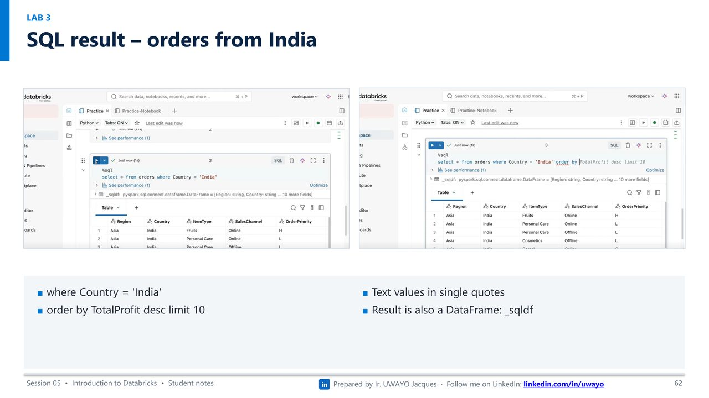

Other magic commands: `%python`, `%scala`, `%r`, `%md` (Markdown) and `%fs` (file system). After a `%sql` cell the result is also available in Python as the DataFrame `_sqldf`.

> **Warning**
>
> *[TABLE_OR_VIEW_NOT_FOUND] The table or view `orders` cannot be found* in the notebook usually means the `createOrReplaceTempView` cell was **not run**. A cell only knows what earlier cells have actually run. Run the cells in order, or use **Run all**.

### Step 3: generate code with AI

In an empty cell press **Cmd/Ctrl + I** (or select *generate with AI*) and type, for example: *I have a csv file Order.csv in my volume, read it and display the result*. The assistant shows the code; select **Accept**, **Reject** or **Run suggested**.

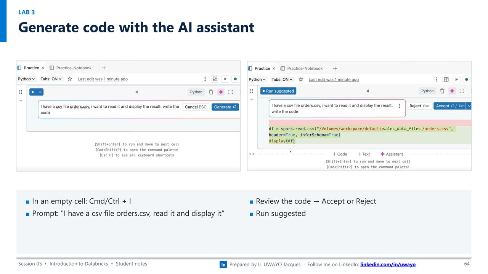

The AI only knows what you tell it. In class the prompt said `orders.csv`, so the generated code failed with **PATH_NOT_FOUND**: the file is `Order.csv`. Always read AI code before you run it.

### Step 4: diagnose errors

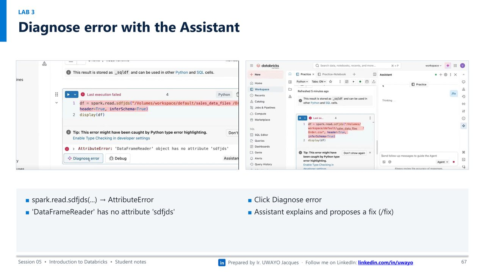

When a cell fails, select **Diagnose error**. The Assistant panel explains the error (`/fix`) and proposes a change you can accept and run.

| Error in class | Cause | Fix |
| --- | --- | --- |
| `PATH_NOT_FOUND` | Wrong file name (`orders.csv` instead of `Order.csv`) | Copy the path from Catalog Explorer |
| `SyntaxError: unmatched ')'` | An extra closing bracket | Count brackets and quotes |
| `AttributeError: 'DataFrameReader' object has no attribute 'sdfjds'` | Wrong method name | Use `spark.read.csv` |

## 8. Lab 4: create a table

### Why a table?

Open **SQL Editor**, attach the **Serverless Starter Warehouse** and run `select * from orders`. It fails with **TABLE_OR_VIEW_NOT_FOUND**. The temporary view lives only in the notebook session; the SQL editor, dashboards, Genie and other users cannot see it. To share data you must save it as a **table**.

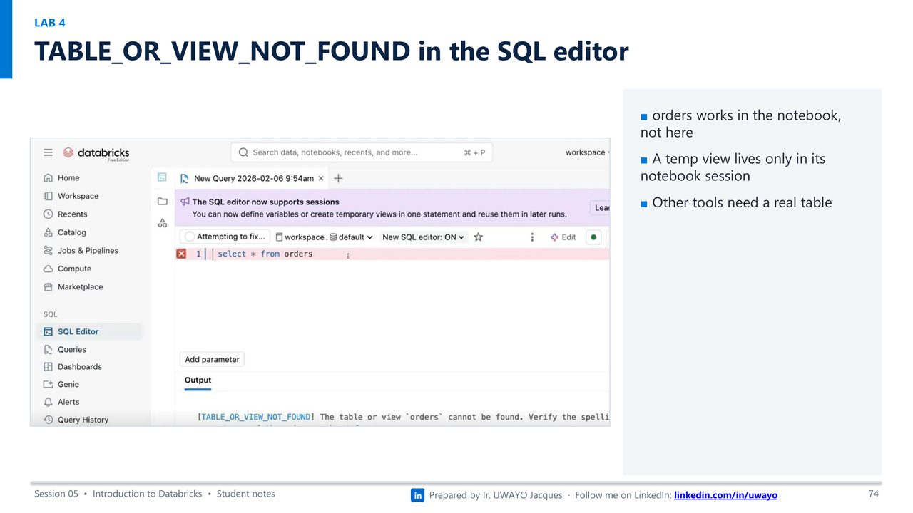

### Step 1: save the DataFrame

```python
df.write.saveAsTable("orders")
```

This creates the **managed Delta table** `workspace.default.orders` (Delta = Parquet files plus a transaction log). If the table already exists, use a mode:

```python
df.write.mode("overwrite").saveAsTable("orders")   # replace
df.write.mode("append").saveAsTable("orders")      # add rows
```

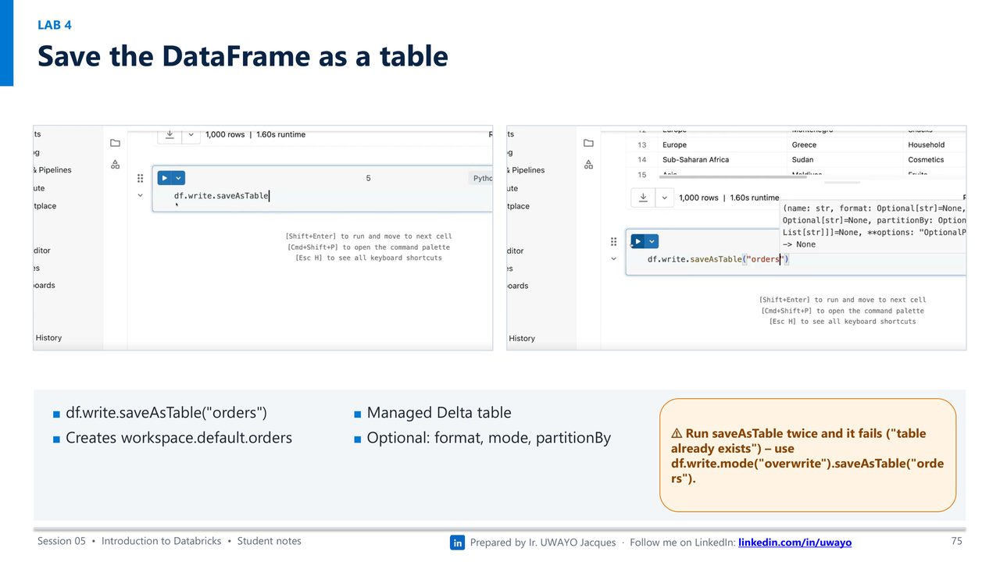

### Step 2: validate

- In the notebook, `%sql select * from orders` returns the 1,000 orders.
- In **Catalog → workspace → default** you now see **Tables (1)** with `orders` next to **Volumes (1)** with `sales_data_files`.
- The table page shows the columns, an **AI suggested description** you can accept or edit, **Sample Data**, **Details**, **Permissions**, **History** and **Lineage**.
- In the **SQL editor**, `select * from orders` now returns 1,000 rows.

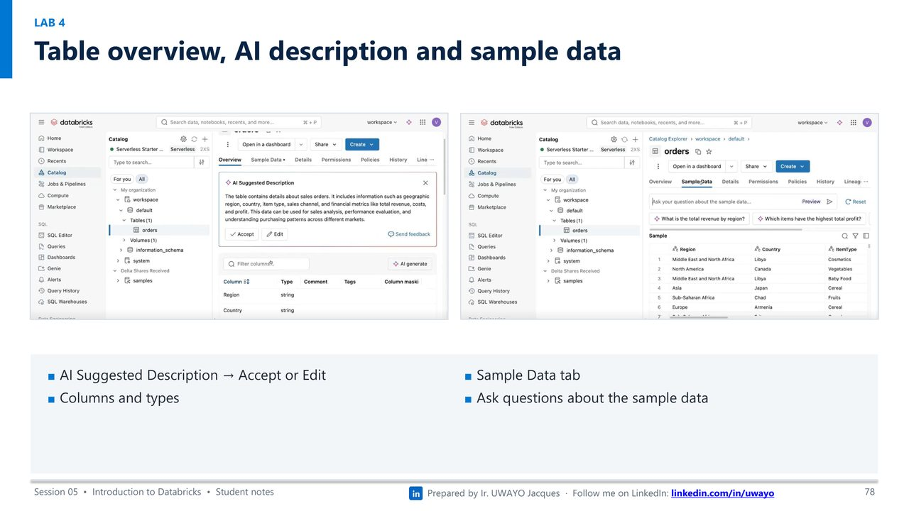

### Permissions

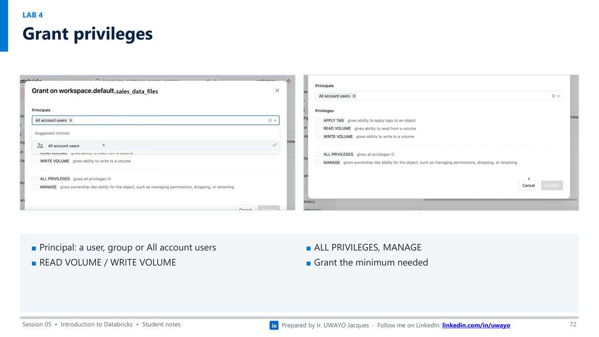

Every Unity Catalog object has an owner and permissions. Open an object, then **Share → Manage permissions → Grant**, choose principals (users or groups) and privileges:

| Privilege (volume) | Meaning |
| --- | --- |
| `READ VOLUME` | Read files |
| `WRITE VOLUME` | Add or delete files |
| `APPLY TAG` | Add tags |
| `ALL PRIVILEGES` | Everything |
| `MANAGE` | Ownership-like rights: manage permissions, drop, rename |

Follow the **principle of least privilege**: give users only what they need.

## 9. Lab 5: Genie

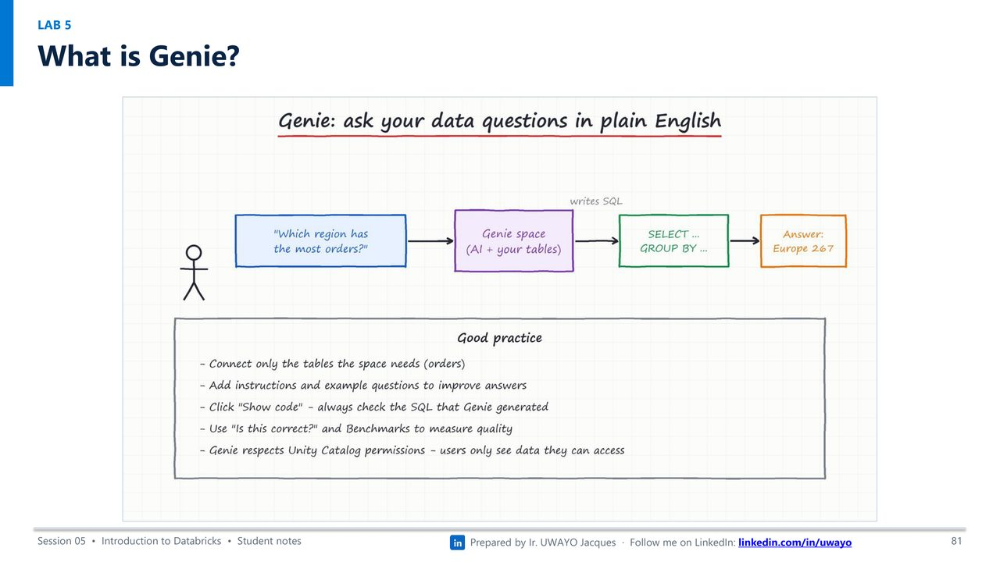

**Genie** lets users ask questions about data in plain English. A **Genie space** is connected to one or more tables. Genie writes SQL, runs it on a SQL warehouse and shows the answer, a result table and the SQL. It respects Unity Catalog permissions.

### Steps

1. Select **Genie → + New**.
2. In **Connect your data**, choose the `orders` table (`workspace.default`) and select **Create**.
3. Ask: *Which is the country with the most orders?*
4. Select **Show code** to read the SQL Genie wrote.

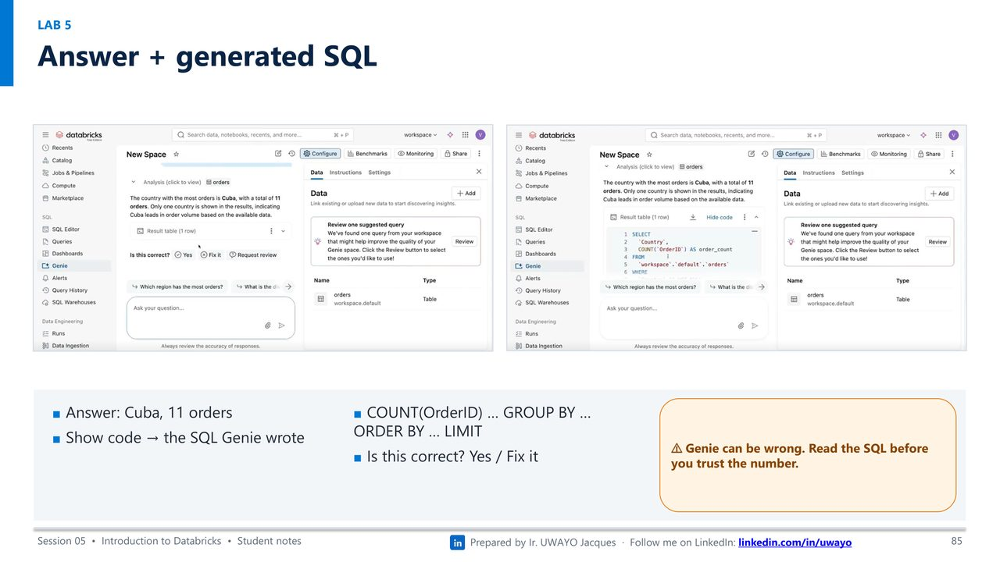

### Results with Order.csv

| Question | Answer |
| --- | --- |
| Which country has the most orders? | Cuba, 11 orders |
| Which region has the most orders? | Europe, 267 orders |
| What is the amount of the biggest order? | TotalRevenue 6,617,209.54 |

The SQL for the first question looks like this:

```sql
SELECT Country, COUNT(OrderID) AS order_count
FROM workspace.default.orders
WHERE Country IS NOT NULL
GROUP BY Country
ORDER BY order_count DESC
LIMIT 1
```

> **Tip**
>
> Genie can be wrong. Always check the SQL with **Show code**, give feedback with **Is this correct?**, and improve the space with **Configure** (instructions and example queries) and **Benchmarks**.

## 10. Troubleshooting

| Problem | Cause | Fix |
| --- | --- | --- |
| Columns `_c0`, `_c1` … | No header option | `header=True` |
| All columns are `string` | No type detection | `inferSchema=True` or a schema |
| `TABLE_OR_VIEW_NOT_FOUND` in the notebook | The temp-view cell was not run | Run cells in order |
| `TABLE_OR_VIEW_NOT_FOUND` in the SQL editor | A temp view is session-only | `saveAsTable` |
| `PATH_NOT_FOUND` | Wrong file name or case | Copy the path |
| `SyntaxError` | Brackets or quotes | Fix the syntax |
| `AttributeError … has no attribute` | Wrong method name | Check spelling or use **Diagnose error** |
| Table already exists | `saveAsTable` run twice | `.mode("overwrite")` |
| Not enough CPU cores | Subscription quota | Fewer workers or request more quota |

## 11. Best practices

- Practise in **Free Edition**; never leave a paid cluster running. Always set **auto-termination**.
- Prefer **LTS** runtimes for production jobs.
- Use **volumes for files** and **tables for data**.
- Define schemas explicitly for large or production files.
- Give temp views and tables different names (for example `vw_orders` and `orders`).
- Copy paths from Catalog Explorer; Unity Catalog names in lower case with underscores.
- Read and test AI-generated code and Genie SQL before you trust it.
- Grant the minimum privileges needed.

## Frequently asked questions

| Question | Short answer |
| --- | --- |
| Is Databricks free? | Free Edition is free for learning; Azure Databricks is pay per use (DBUs plus VMs). |
| Do I need Scala? | No. PySpark and SQL cover most data engineering jobs. |
| Spark or pandas? | pandas runs on one machine; Spark runs on a cluster. Use Spark for big data. |
| Databricks or ADF? | Both: ADF copies and orchestrates, Databricks transforms. ADF can run a Databricks notebook as an activity. |
| What format is a Databricks table? | Delta Lake by default (Parquet files plus a transaction log). |
| Volume or table? | A volume for files, a table for queryable data. |
| Managed or external? | Managed: Databricks controls the storage. External: your own ADLS path. |
| Is Genie always correct? | No. Check the SQL and add instructions and benchmarks. |

## Wrap-up and next steps

### Key takeaways

- **Big data** is too big, too fast or too varied for one machine, so the work is split across a **cluster**.
- **Spark** is the engine, **PySpark** is its Python API, and **Databricks** is the managed platform built by Spark's creators.
- **Volumes** hold files; **tables** hold data (Delta). Names follow **catalog.schema.object**.
- For CSV files use `header=True` and `inferSchema=True`, or define a schema.
- A **temporary view** lives only in its notebook session; `saveAsTable` shares the data with the SQL editor, Genie and other users.
- **Genie** answers questions in plain English. Always check the SQL.

### Prepare before Session 6

Session 6 is **Resume and How to Crack a Data Engineer Interview**. Before Session 6:

- Finish the assignment below and keep your Free Edition workspace.
- Write down the projects you built in Sessions 2 to 5 (ADF pipelines, Parquet, Databricks table, Genie): they become your resume and portfolio.
- Bring your questions.

## Practice: quiz and assignment

### Quiz

1. Which V describes data that arrives very fast?
   - A. Volume
   - B. Velocity
   - C. Variety
   - D. Value
2. What does the driver node do, and what do the worker nodes do?
3. Is a JSON file structured, semi-structured or unstructured?
4. In which language is Spark written, and on what does it run?
5. What is the difference between Spark, PySpark and Databricks?
6. Why do companies prefer LTS runtimes?
7. A cluster has 10 workers of 4 cores and a 4-core driver. How many cores does it need?
8. You read a CSV and the columns are called `_c0`, `_c1`. Which option fixes it?
9. All columns are `string`. Which option makes `UnitsSold` an integer?
10. Your `%sql` cell fails with *TABLE_OR_VIEW_NOT_FOUND*, but the code is correct. What is the most likely cause?
11. Why can the SQL editor not query a temporary view?
12. What is the full three-level name of the table you created?
13. Which privilege lets a user read files in a volume without changing them?
14. Why should you check the SQL that Genie generates?

<details>
<summary>Show the answers</summary>

1. B. Velocity.
2. The driver plans the job and splits it into tasks; the workers run the tasks in parallel on parts of the data.
3. Semi-structured: it carries its structure with keys, and records can differ and be nested.
4. Scala. It runs on the Java Virtual Machine (JVM).
5. Spark is the open-source engine, PySpark is its Python API, and Databricks is a company and managed platform that runs Spark and adds features (Runtime and Photon, Delta Lake, Unity Catalog, Genie).
6. LTS (long-term support) versions are supported for a long time and are stable for production.
7. 44 cores (10 × 4 + 4).
8. `header=True`.
9. `inferSchema=True`, or an explicit schema.
10. The cell that runs `createOrReplaceTempView("orders")` was not run in this session.
11. A temporary view exists only in the notebook session that created it. Other tools need a table saved in Unity Catalog.
12. `workspace.default.orders`.
13. `READ VOLUME`.
14. Genie can misunderstand a question or choose the wrong column. The SQL shows exactly what was calculated.

</details>

### Assignment

1. Create your own Free Edition workspace and rebuild Labs 1 to 5 without watching the recording.
2. With `%sql`, calculate the total revenue per `Region` and per `ItemType` (`group by`), sorted from highest to lowest.
3. Read `Order.csv` with an explicit schema instead of `inferSchema`.
4. Save a table `orders_india` that contains only the orders from India, using `mode("overwrite")`.
5. Ask Genie three new questions and check the SQL each time.
6. Bonus: upload a JSON file to the volume and read it with `spark.read.json`.

**What to submit:** A screenshot of your `orders` table in Catalog Explorer and a screenshot of one Genie answer with its SQL. Share them the way your instructor asks (for example in the course group), and hide your email address. Never include passwords, access tokens or card details.

## Key terms

| Term | Meaning |
| --- | --- |
| Big data | Data too large, fast or varied for one machine (the 5 Vs) |
| Cluster | A group of machines: one driver and several workers |
| Apache Spark | An open-source, in-memory, distributed processing engine |
| PySpark | The Python API for Spark |
| Spark SQL | The SQL API for Spark (`%sql`) |
| Py4J | The bridge between Python and the Spark engine on the JVM |
| Databricks | The company founded by Spark's creators, and its data and AI platform |
| Databricks Runtime | The Spark version plus Databricks libraries used by a cluster |
| Photon | The Databricks engine that speeds up SQL and DataFrame work |
| DBU | Databricks Unit: the billing unit per hour of compute |
| Autoscaling / auto-termination | Add and remove workers automatically / stop an idle cluster |
| SQL warehouse | Compute for SQL queries, dashboards and Genie |
| Unity Catalog | Databricks governance: catalogs, schemas, tables, volumes and permissions |
| Volume | A Unity Catalog object that stores files |
| DataFrame | A distributed table with named, typed columns |
| `header` / `inferSchema` | CSV options: use the first line as column names / detect types |
| Temporary view | A SQL name for a DataFrame, valid only in the current session |
| `saveAsTable` | Writes a DataFrame as a permanent table |
| Delta Lake | Parquet files plus a transaction log (ACID, time travel) |
| Genie | A Databricks feature to ask data questions in plain English |

<a href="https://www.linkedin.com/in/uwayo/"></a> **Prepared by Ir. UWAYO Jacques** · [Follow me on LinkedIn](https://www.linkedin.com/in/uwayo/)
